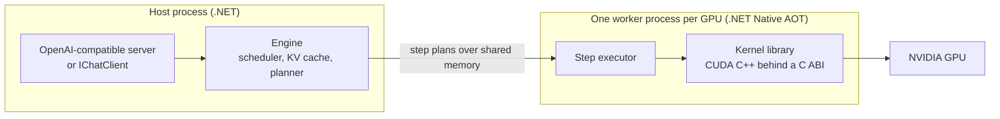

# Roost

Roost is a C# LLM serving engine for NVIDIA GPUs, built to be a whole replacement for vLLM. It serves the [Starling](https://github.com/starlinghq/starling) model library behind an OpenAI-compatible API, or inside a .NET application through `IChatClient`. There is no Python or libtorch at runtime.

> **Pre-release.** Nothing is published, and no capability is `supported` yet. Roost is not ready for production or for general use. See [Status](#status).

## Why Roost

- **.NET from the API down to the step loop.** The scheduler, KV cache and server are C#, and the `roost` server and GPU worker compile with Native AOT. Kernels are CUDA C++ behind a versioned C ABI, with Rust for a few host-side native libraries.
- **A GPU fault stays in its worker.** Each GPU is driven by its own worker process, so a sticky CUDA fault never takes down the host or the application that embeds Roost.
- **Hybrid models are first-class.** The first model is Qwen3.5-0.8B, which mixes full-attention and Gated DeltaNet layers and keeps two kinds of state.
- **Evidence before numbers.** Every served profile must pass Roost's fidelity gates, in `evidence/`, before any throughput figure is published.
- **An explicit status for everything.** Each capability is `supported`, `experimental`, `untested` or `unsupported`. Missing never means supported.

Speed targets are listed in the [charter](.github/CHARTER.md#targets). They are targets, not claims: each is published only when the scorecard measures it against a pinned vLLM release.

## Architecture



[Starling](https://github.com/starlinghq/starling) works out the models. Roost runs on top of it and consumes Starling's published NuGet packages, pinned exactly, and nothing else (build plan section 2.2). ONNX Runtime may appear in host packages, for Starling's pooling models, and never in the worker, which pins its own CUDA runtime and allocator.

## Status

The road to a full replacement runs through seven gates, M0 to M6, with ROCm after them as M7. Roost is working toward the first. On `main` today:

| Area | State |
| --- | --- |
| Qwen3.5-0.8B greedy decode and `IChatClient` chat on the eager worker | Ran on an RTX 3090 (SM 86) and an RTX 4060 Ti (SM 89) in October, with committed evidence |
| Server routes, async scheduling, sampling, tool-call parsers, sleep and wake, and more | Built and tested on the CPU path only; no GPU evidence |
| Kernel library on current `main` | **Refused by the loader until it is rebuilt.** The kernel manifest is at ABI 1.2 and the loader needs 1.3 ([#155](https://github.com/starlinghq/roost/issues/155)) |
| Protected fixtures and tolerances | Proposed, not adopted, so nothing can reach `supported` |
| Packages, images and releases | None published |

The [capability table](docs/capabilities.md) gives every capability's status and evidence. The [triage plan](docs/plan/triage-2026-11.md) gives the current order of work, and each issue's `status:*` label says what it is waiting on.

| Gate | What it proves |
| --- | --- |
| M0 | Qwen3.5-0.8B parity against protected fixtures; contracts promoted to v1. Preview 1 follows |
| M1 | Serving core: concurrency, CUDA graphs, structured output, tool calling, worker recovery |
| M2 | MoE, speculation and quantisation, with a consumer-card scorecard against vLLM and SGLang |
| M3 | Coverage and onboarding: unseen models in under a day, multi-LoRA, kernel candidates, soak |
| M4 | Parallelism across GPUs and nodes, and a large MoE model |
| M5 | Disaggregated serving, KV tiers, multimodal input and long context |
| M6 | The replacement gate: every parity row `supported` or excluded |
| M7 | ROCm |

## Building

Prerequisites: the .NET SDK version pinned in [`global.json`](global.json). The CPU path needs nothing else.

```sh
git clone https://github.com/starlinghq/roost
cd roost
dotnet test --solution Roost.slnx
```

The default solution runs on the CPU, against `CpuOps` and small seeded models, and needs no GPU or weights. Starling is restored as exact NuGet pins in locked mode; there are no submodules.

The kernel library and the `*.Cuda` test projects need the CUDA toolkit and a GPU and are not in the solution. See [kernels/README.md](kernels/README.md). A console chat over `IChatClient` is in [samples/ChatConsole](samples/ChatConsole), and the `roost` server and its image are described in [deploy/README.md](deploy/README.md). Both need a kernel library built for your GPU and the locked model checkpoint, and with nothing on nuget.org yet the sample also needs a local package feed.

## Repository layout

| Path | Contents |
| --- | --- |
| `src/` | The engine, server, worker, model compiler, reference ops and `Starlings.Generation.Roost` |
| `kernels/` | The CUDA kernel library and its manifest; binaries are release assets, never committed |
| `native/` | Host-side Rust libraries behind a C ABI |
| `evidence/` | Roost's evidence pipeline, model registry and proposed fixtures |
| `benchmarks/` | The serving-load harness for the scorecard |
| `tests/` | CPU tests, plus local-only GPU projects |
| `deploy/`, `samples/` | The container image and a console sample |
| `spikes/`, `docs/m0/` | Spike code and reports |

## Documentation

- [Capability table](docs/capabilities.md): what works today, with evidence.
- [Triage plan](docs/plan/triage-2026-11.md): what happens next, and why.
- [Build plan](docs/plan/build-plan.md): the backlog, streams and gates. Section 13 defines "replacement" and section 14 how Roost aims to be faster.
- [Charter](.github/CHARTER.md) and [decision log](docs/kickoff.md).
- [Contracts](docs/contracts.md): C1 to C9 and every change to them.
- [Changelog](CHANGELOG.md) and [releasing](docs/releasing.md).

## Contracts

Contracts C1 to C9 are the fixed seams between the kernels, worker, engine and frontend. They are at stage v0 and contract version 6, and they change only through stream A until the M0 gate promotes them to v1. The record that used to be in this section, including each spike finding and every change after the freeze, is now [docs/contracts.md](docs/contracts.md).

## Contributing

Rules for contributors and agents are in [AGENTS.md](AGENTS.md). Start from a backlog item in build plan section 10 and its issue, and stay in that stream's paths. Fixtures and tolerances in `evidence/protected/` are changed only by the maintainer.

## License

Roost is licensed under either the [MIT License](LICENSE-MIT) or the [Apache License 2.0](LICENSE-APACHE), at your option. Third-party sources are listed in [THIRD-PARTY-NOTICES.md](THIRD-PARTY-NOTICES.md) and [PROVENANCE.md](PROVENANCE.md).
