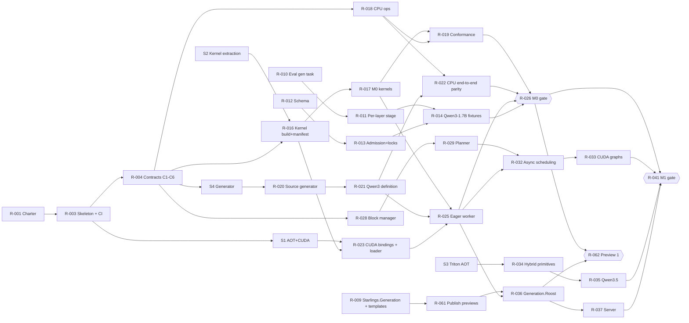

# Roost build plan

## Parallel work streams from the Roost PRD to V1

Source: Roost PRD (2026-10-12, Mark). Written 2026-10-13. Status: proposed, for maintainer review. This document turns the PRD into work that agents and engineers can run in parallel. Roost lives in its own repository, `starlinghq/roost`. That replaces the PRD's "roost/ in the Starling monorepo" decision: Roost uses Starling but is a separate product, as `starlinghq/tokenizers` is. Only the library prerequisites (PRD P0) are changes to `starlinghq/starling`.

An adversarial review of this plan and the PRD is in `docs/plan/review.md`; its applied changes are folded in below and its product-direction changes are decisions 11 to 15 in section 11.

The Starling facts were re-checked on 2026-10-16 against `main` at `9a5c143` and the local toolkit. Section 2.1 records what changed; decisions 16 and 17 are new.

This document does not restate the PRD's design. It states what is built, in which order, by whom, against which contract, and what each piece of work needs (GPU, review hours, decisions). Where Starling's code today differs from what the PRD assumes, section 2 records the difference and the plan follows the code.

## 1. Summary

Roost has three kinds of work with very different constraints:

1. **Host work that needs no GPU**: engine core, CPU reference ops, model compiler, frontend, evaluator extensions. It can run on hosted CI and cloud agent sessions, and is limited only by review capacity.
2. **GPU work**: kernel library, worker, parity runs. It is limited by two shared local GPUs, the 40 GPU-hour monthly cap and one scarce skill (CUDA). This is the critical path.
3. **Library prerequisites (PRD P0)**: generation contract extraction, evaluator generation task, manifest fields, Qwen3-1.7B admission and fixtures. They are pull requests to `starlinghq/starling` (`ai-dotnet/` and `model-pipeline/`), reviewed under that repository's rules, and touch packages already in a release candidate.

The plan makes these three run concurrently instead of in sequence. The PRD runs P0 strictly before M0. Here P0 runs beside the start of M0, because only the M0 parity gate needs P0's evaluator and fixtures; the kernel library, CPU reference backend and model compiler do not. The PRD's own risk table already allows this ("M0 starts the kernel library and CPU backend, which need no evaluator"). Making it the default takes P0 (3 weeks, or 6 at recorded capacity) off the critical path.

Two mechanisms make the parallelism safe:

- **A contract freeze (C0)** in the first two weeks: the C ABI header, the step plan and step result layouts, the op vocabulary signatures, the state-group descriptor, the engine/frontend request types, and the kernel manifest schema. They are merged as compiling stubs before any stream builds against them. After C0, a stream only meets another stream at a contract, never inside another stream's code.
- **Disjoint path ownership (section 4)**: every stream owns its directories. An agent never edits a path another stream owns. Cross-stream changes go through a contract-change PR owned by the integration stream (A).

The scarce resources are maintainer review hours (20 a week recorded) and GPU time, not agents. Section 9 sets work-in-progress limits from them.

The first thing anyone outside the project can use is **Preview 1** (R-062), straight after the M0 gate: preview NuGet packages that run Qwen3 in-process on an NVIDIA card from C# behind `IChatClient`, with greedy parity evidence and every unbuilt capability marked `unsupported`. The server, concurrency, CUDA graphs and the vLLM comparison then improve a product that already exists. This is decision 11; the review's finding 1 gives the reasons.

## 2. Starling facts that adjust the PRD

Checked against `starlinghq/starling` `main` at `fb27658` and nuget.org on 2026-10-13.

| PRD statement | Starling today | Consequence for this plan |
| --- | --- | --- |
| Repository: `roost/` in the Starling monorepo, project references until the packages are on nuget.org | Superseded: Roost is `starlinghq/roost` (private until the licence review). Of the packages Roost needs, only `Starlings.Tokenizers` (0.3.0-preview.1) is on nuget.org; `Starlings.Acquisition` and the generation packages are not published | Roost consumes Starling through a git submodule pinned by full SHA until the packages are published, then by exact package pins (section 3.1). R-061 publishes them. |
| Packages carry the `Starling` prefix (`Starling.Generation`, `Starling.Generation.Roost`) | The settled prefix is `Starlings` (`docs/kickoff.md`); every project is `Starlings.*` | Packages are `Starlings.Generation`, `Starlings.Generation.Roost` and `Starlings.Roost.*`. The org is `starlinghq` on GitHub and `Starlinghq` on Hugging Face. |
| The tokenizer is a library component in the monorepo | `Starlings.Tokenizers` is released from `starlinghq/tokenizers` and pinned exactly in `ai-dotnet/Directory.Packages.props` | Any new tokenizer profile is a tokenizers-repo release followed by a pin raise, never a change in Roost. Roost pins `Starlings.Tokenizers` from nuget.org exactly. |
| The decode loop and backend contract exist and "move into Starling.Generation" | The decode loop lives in `ai-dotnet/src/Starlings.Generation.OnnxGenAI/` (`TextGenerator.cs`, `StopSequenceMatcher.cs`, `IncrementalDetokenizer.cs`) and is coupled to GenAI types. There is no abstractions package. Consumers: `Models.Qwen35`, `Models.QwenChat`, `Models.Qwen35.Extensions.AI` | The extraction is real refactoring of a released package (0.1.0-preview.5) with two consumers, not a move. It is R-009, with an unchanged-evidence acceptance criterion. |
| Roost reuses the library's chat templates | `Qwen35ChatTemplate` and `QwenChatTemplate` live in `Models.Qwen35` and `Models.QwenChat`, which reference `Generation.OnnxGenAI` and so bring `Microsoft.ML.OnnxRuntimeGenAI.Managed` | R-009 also moves the template renderers and chat profiles into a package whose dependency closure has no `Microsoft.ML.OnnxRuntime*`. A Roost boundary check (R-003) keeps it that way. This is the largest P0 item. |
| The evaluator is "extended with a generation task" | There is no generation task or per-layer stage. A format v3 generation spec exists in `docs/evidence/p016-qwen35/README.md` section 10, plus a development-only evaluator (`evaluate_generation_candidate.py`) | R-010 builds format v3 from that spec. R-011 adds the per-layer stage and the hook capture in the reference runner. |
| The near-tie bound for "the current fp16x profile" is 0.015 | 0.015 is the margin observed in the fp16x divergences. The protected `ortgenai-fp32x-cuda` tolerance uses `exact_except_listed_margin_below_1e-3`, and the proposed fp16x rule uses 0.05 | The bound is a per-profile protected value that the maintainer sets in R-014 and R-015. The plan assumes no number. |
| M0 model Qwen3-1.7B: tokenizer "already covered" | `Models.QwenChat` and the `qwen3` candidate cover Qwen3-0.6B (CPU fp32, template `qwen3-text-v1`). There is no 1.7B admission, lock or fixtures | R-013 admits Qwen3-1.7B and verifies that its `tokenizer.json` and template digests match the 0.6B profile. If they differ, a tokenizer-repo profile is added first. |
| The benchmark harness is reused for serving load | `starlings-bench-raw/1` exists, but the harness is encoder-only (`Benchmarks.E5Harness`) | R-047 adds a generation `kind` to the raw schema and a serving-load harness. |
| Manifests carry the Roost profile fields | `model-manifest.schema.json` has no field for kernel revision, GPU or SM, driver, KV dtype or attention backend (the Qwen manifest notes this gap) | R-012 extends the schema before any Roost manifest is written. |
| Native AOT host | No project in the repository sets `PublishAot` or `IsAotCompatible` | AOT is unproven here. Spike S1 (R-005) qualifies it with CUDA interop and ASP.NET before anything depends on it. |
| Build targets SM 86, 89 and 90 in V1 | Not a Starling fact, but the first plan draft built SM 86 and 89 only | SM 90 is built from R-016 by a build-only CI job (nvcc needs no GPU); it is validated on hardware with R-047 and R-048. The SM list is a manifest field, and an SM without hardware evidence is `untested`. |
| Charter amendment needed | `.github/CHARTER.md` line 13 puts "distributed serving" and "bespoke GPU kernels" out of scope | The organisation charter lives in `starlinghq/starling`, so R-001 is a PR there. No Roost code merges before it. |
| "Agent-instructions row" | Starling's agent rules are in its `CLAUDE.md` (Layout list, Commands, Bounded authority) | Roost gets its own `CLAUDE.md` in R-003, carrying Starling's bounded-authority rules plus the Roost ones (kernel SHAs, no Python under `src/`, GPU leasing). Starling's `CLAUDE.md` gains one line pointing at Roost. |

### 2.1 Re-check on 2026-10-16

Checked against `starlinghq/starling` `main` at `9a5c143` (#87) and the local development host. Rows above that these supersede are corrected in place where they drive a backlog item.

| Area | Then (`fb27658`, 2026-10-13) | Now (`9a5c143`, 2026-10-16) | Consequence |
| --- | --- | --- | --- |
| Published packages | Only `Starlings.Tokenizers` on nuget.org | All 13 ai-dotnet packages in `docs/releases/ai-0.1.0-preview.6.md` are on nuget.org at `0.1.0-preview.6`, **including `Starlings.Acquisition`**. `Starlings.Models.QwenChat` is not yet published. Kickoff sets the next ai-dotnet version to `0.2.0` with no suffix; maturity is per profile, not a package label | Roost pins `Starlings.Acquisition` from nuget.org from the start. R-061 shrinks to `Starlings.Generation` and the template package, released in the ai-dotnet release train (`0.2.0` or a later preview), not as a separate preview set |
| Generation contract (R-009) | Not started | Unchanged: no `Starlings.Generation`; `TextGenerator`, `StopSequenceMatcher` and `IncrementalDetokenizer` still in `Generation.OnnxGenAI`; templates still in `Models.Qwen35` and `Models.QwenChat` (both reference `Generation.OnnxGenAI`) | R-009 remains the largest P0 item. Its release must fit the `0.2.0` train: either before it, or the extraction keeps type forwarders through it |
| Generation evaluation (R-010) | Development-only `evaluate_generation_candidate.py` | `model-pipeline/src/model_pipeline/evaluate_generation.py` evaluates generation with its own `starlings.generation-fixture` v1 format and stages `tokenizer`, `dotnet-ids`, `dotnet-text`. `stage-results.schema.json` still accepts format 1 and 2 only | R-010 builds format v3 over `evaluate_generation.py` and converts `starlings.generation-fixture` v1, rather than starting from the candidate script |
| Manifest schema (R-012) | No Roost fields | Unchanged | No change |
| Qwen3-0.6B | Assumed admitted (decision 15) | A `proposed` five-model onboarding candidate (`model-pipeline/candidates/qwen3/profile.json`); not in `registry/`, no file in `admissions/`, though `FIVE_MODELS.md` and the QwenChat README call it admitted. Qwen3-1.7B appears nowhere | Decision 15's premise is weaker: 0.6B still needs a registry entry and admission record before it can carry an M0 gate, so the saving over 1.7B is smaller than review finding 9 says (see the decision text) |
| Charter (R-001) | Out of scope: distributed serving, bespoke GPU kernels | Unchanged; nothing in starling names Roost | R-001, R-002 and R-059 are still the first starling PRs |
| GPU time | Local only, "no paid cloud GPU", 40 GPU-hours a month (kickoff, provisional) | CUDA qualification runs on RunPod secure-cloud RTX 3090 pods (`qualification.yml` job `cuda (runpod)`, `tools/ci/runpod.py`, balance floor and backstop timeout). Kickoff's budget row still says "no paid cloud GPU"; no RunPod budget is recorded | Decision 16. If Roost may use RunPod, parity and gate runs on SM 86 need not compete with local development time, and the week-6 checkpoint (section 7.2) changes |
| CUDA toolkit | Implicitly CUDA 12 (library names `libcudart.so.12`, `cudart64_12.dll`; cuBLASLt sizes) | The development host has CUDA 13.3 (nvcc 13.3.73, driver 610.57). SM 86, 89 and 90 remain supported by CUDA 13 | Decision 17. S1 and S2 run against 13.3 unless the maintainer pins 12.x; R-023's per-OS resolver takes the major version from the manifest rather than hard-coding 12 |
| Local devices | RTX 3090 and RTX 4060 Ti, shared | Unchanged. The 4060 Ti is often near full (15.5 of 16 GB in use on 2026-10-16), so `gpu-lease`'s free-memory check matters from the first spike | No change; S1 and S2 may need the 3090 when the 4060 Ti is occupied |
| SDK | Starling and tokenizers pin `10.0.100` | This host has only `10.0.401`, which a `10.0.100` pin does not resolve to | Roost pins `10.0.401` with `latestPatch` (R-003) |

## 3. Repository layout

**Why build an engine rather than a host over an existing runtime.** llama.cpp and ONNX Runtime GenAI already run on CUDA, Windows and consumer GPUs. Roost's product is fidelity evidence and a host-owned scheduler: neither runtime exposes typed, paged state groups or a step plan the host controls, llama.cpp's numerics are not referenced against transformers fp32, and Starling already ships ONNX Runtime GenAI for the in-process path and recorded where it diverges. The op-level `IRoostOps` boundary keeps a second backend (Vulkan, ROCm) possible later. Reopen this only with new evidence.

**Windows stays open.** Windows x64 is `untested` in V1 (PRD), but nothing may close it: no POSIX types in the C ABI, the kernel library's CMake builds with MSVC in CI (build only), and the loader resolves library names per OS. WSL2 is documented from Preview 1 and stays `untested` until someone with a Windows host runs the R-062 drill.

`starlinghq/roost` has its own solution, central package file, CI, release workflow and provenance files, following `starlinghq/tokenizers`. It copies Starling's root build conventions (`net10.0`, `TreatWarningsAsErrors`, central and locked package versions, `global.json` SDK pin) rather than inheriting them.

```
starlinghq/roost
  Roost.slnx
  Directory.Build.props  Directory.Packages.props  global.json   # same conventions as starling
  CLAUDE.md  README.md  THIRD-PARTY-NOTICES.md  PROVENANCE.md
  external/starling/                  # git submodule pinned by full SHA (section 3.1); removed once packages ship
  .github/workflows/                  # ci.yml (hosted, CPU), release.yml (kernel assets, packages, image)
  kernels/                            # native, CMake; never in Roost.slnx
    include/roost_kernels.h           # the C ABI (contract C1)
    manifest.toml                     # upstreams, SHAs, patch sets, ops, specialisations, digests (C5)
    upstream/<name>.patches/          # patch sets only; sources fetched by SHA at build time
    src/ops/                          # C ABI wrappers, one file per op family
    aot/                              # Triton AOT build scripts (build-time Python only)
    CMakeLists.txt
  src/
    Starlings.Roost.Abstractions/     # StepPlan, StepResult, StateGroupDescriptor, Request, TokenEvent, RoostError (C2, C4, C6)
    Starlings.Roost.Ops/              # op vocabulary (C3) + CPU reference backend
    Starlings.Roost.ModelCompiler/    # Roslyn incremental source generator (netstandard2.0)
    Starlings.Roost.Models.Qwen3/     # model definitions, one project per family
    Starlings.Roost.Models.Qwen35/
    Starlings.Roost.Cuda/             # bindings generated from pinned CUDA, cuBLASLt and NVML headers
    Starlings.Roost.Kernels/          # kernel library loader, ABI and digest check, op registry, CUDA ops backend
    Starlings.Roost.Engine/           # scheduler, block manager, prefix cache, rings, admission
    Starlings.Roost.Worker/           # device allocator, streams, graphs, weight streaming, sampler launch
    Starlings.Roost.Server/           # ASP.NET Core host, OpenAI routes; publishes the `roost` binary
    Starlings.Generation.Roost/       # in-process backend for Starlings.Generation
  tests/
    Starlings.Roost.*.Tests/          # CPU, in Roost.slnx, run in CI
    Starlings.Roost.*.Tests.Cuda/     # local only, not in Roost.slnx (as in ai-dotnet)
    Starlings.Roost.Conformance/      # kernel conformance runner (CPU half runs in CI)
  benchmarks/
  tools/
    gpu-lease                         # device lock, free-memory check, GPU-hour ledger (section 8)
    generate-cuda-bindings.py         # same pattern as starling's tools/generate-ffmpeg-bindings.py
```

Library-side work stays in `starlinghq/starling`, in the places it lives today: `ai-dotnet/src/Starlings.Generation/` (new), and `model-pipeline/schemas`, `src`, `registry`, `protected` (maintainer only), `recipes` and `reference`.

### 3.1 How Roost consumes Starling

| Starling piece | Used by Roost as | Until it is published |
| --- | --- | --- |
| `Starlings.Tokenizers` | Exact package pin from nuget.org | Already published |
| `Starlings.Acquisition` | Exact package pin from nuget.org | Published at `0.1.0-preview.6` (section 2.1) |
| `Starlings.Generation`, the template package from R-009 | Exact package pins | R-061 publishes them in P0, directly after R-009, in the ai-dotnet release train. Until then, project references into `external/starling`, a submodule pinned by full commit SHA; keep this window short. Those projects resolve starling's `Directory.Packages.props` and lock files, not Roost's, so any shared package pinned differently in the two repositories (for example `Starlings.Tokenizers`) fails restore as a downgrade error. A CI-built local feed is not an option either: starling recorded that rebuilt `.nupkg` bytes break locked restore (NU1403) |
| `model-pipeline` (evaluator, schema, registry, reference runners) | A test-time and tool-time Python dependency, installed from `external/starling/model-pipeline` at the pinned SHA. Never in the Roost runtime or image | Same submodule |
| Roost profile manifests, protected fixtures and tolerances | Rows in starling's `model-pipeline/registry/` and `protected/`, under starling's protected-evidence workflow. The PRD keeps one evidence pipeline, and the registry is the catalogue source | Not applicable. Roost evidence runs read them through the pinned submodule, so a Roost profile is qualified against a known fixture revision |
| Organisation charter, kickoff decisions | PRs to `starlinghq/starling` | Not applicable |

Because the evaluator and fixtures stay in starling, a Roost profile change touches two repositories: the manifest and fixture PR in starling first, then the submodule raise and evidence in Roost. Section 9's review limits count both.

Two design choices are fixed here because every stream depends on them.

- **Backend dispatch by static abstract interface.** The op vocabulary is an interface with static abstract members (`interface IRoostOps { static abstract void RmsNorm(in RmsNormArgs a); … }`). The generator emits `Forward<TOps>() where TOps : struct, IRoostOps`. `CpuOps` (stream D) and `CudaOps` (stream F) are structs that implement it. Generic instantiations over structs are specialised and devirtualised by both the JIT and Native AOT, so the same generated forward runs on the CPU reference in CI and on the GPU with no interface dispatch or allocation, whether or not the host is AOT-published. AOT is a property of the `roost` binary, never a requirement on the library packages: most ASP.NET services that would host Roost in-process are not AOT. This is what lets streams D, E and F proceed independently: E only needs the interface, not a backend.
- **Compile time knows only the op vocabulary.** The generator checks a definition against C3 and nothing else. Whether a kernel specialisation exists for a dtype, head size or SM is a startup check (R-023), because kernels ship and update separately from managed packages. `Starlings.Roost.Models.*` ship pre-generated forwards, so someone consuming a model package never runs the generator. Someone defining a new model (G6, R-055) references `Starlings.Roost.ModelCompiler` as an analyzer package that depends on C3 only; no build ever reads `kernels/manifest.toml`.
- **Generated CUDA bindings, not a binding package.** `Starlings.Roost.Cuda` is generated from the pinned CUDA toolkit headers by a repository script, following the precedent `tools/generate-ffmpeg-bindings.py`. This keeps the dependency surface pinned and reviewable, and it keeps third-party binding licences out.

## 4. Streams and ownership

Each stream owns its paths and its backlog items (section 10). Paths are in `starlinghq/roost` unless prefixed `starling:`, which means `starlinghq/starling`, reviewed under that repository's `CLAUDE.md`. An agent works in its own worktree, on one item at a time, and opens a draft PR. "Needs GPU" means at least one acceptance criterion needs a local GPU run with committed evidence.

| Stream | Scope | Owns | Needs GPU | Best owner |
| --- | --- | --- | --- | --- |
| **A. Integration and contracts** | Charter and kickoff PRs in starling; repository skeleton, CI, release workflow, boundary checks; the `external/starling` submodule and its SHA raises; contracts C1–C6 and every later contract change; gate assembly; release drill | Root build files, `Roost.slnx`, `CLAUDE.md`, `.github/`, `external/`, `src/Starlings.Roost.Abstractions/`, `kernels/include/`, `tools/`; `starling:.github/CHARTER.md`, `starling:docs/kickoff.md` | No | Primary agent; maintainer approves |
| **B1. Generation contract** | Extract `Starlings.Generation` from `Generation.OnnxGenAI`; move `Models.Qwen35` and `Models.QwenChat` onto it | `starling:ai-dotnet/src/Starlings.Generation/`, edits in `starling:` `Generation.OnnxGenAI`, `Models.Qwen35*`, `Models.QwenChat` | No (CUDA evidence rerun locally once) | Workhorse agent |
| **B2. Evaluator extensions** | Generation task format v3; per-layer stage; transformers hook capture in the reference runner | `starling:model-pipeline/src/model_pipeline/evaluate*`, `starling:model-pipeline/schemas/stage-results.schema.json`, `starling:model-pipeline/reference/generation/` | No | Workhorse agent |
| **B3. Profiles and fixtures** | Manifest schema fields; Qwen3-1.7B admission and locks; safetensors locks; proposed reference fixtures | `starling:model-pipeline/schemas/model-manifest.schema.json`, `registry/`, `admissions/`, `candidates/`; run artifacts outside Git | No (fp32 CPU references) | Small-model agent; maintainer sets tolerances |
| **C. Kernel library** | CMake build, vendoring by SHA, patch sets, C ABI wrappers, Triton AOT, manifest, provenance check, digests, release assets | `kernels/` except `include/` | Yes | CUDA engineer plus agents |
| **D. CPU reference and conformance** | `CpuOps` in double precision for every op; conformance runner; goldens; per-kernel tolerance files (proposed) | `src/Starlings.Roost.Ops/`, `tests/Starlings.Roost.Conformance/` | Only for the GPU half of conformance | Workhorse agent |
| **E. Model compiler and definitions** | Source generator; model definitions and weight maps; tiny CI model; inspect-to-definition mapping | `src/Starlings.Roost.ModelCompiler/`, `src/Starlings.Roost.Models.*/` | No (CPU end to end) | .NET engineer plus agents |
| **F. Worker** | CUDA bindings, kernel loader and registry, device allocator, streams, weight streaming, graphs, sampler, async patching, fault isolation | `src/Starlings.Roost.Cuda/`, `…Kernels/`, `…Worker/` | Yes | CUDA engineer plus .NET performance engineer |
| **G. Engine core** | Rings, block manager, state groups, prefix cache, planner, preemption, admission; recorded-worker replay | `src/Starlings.Roost.Engine/` | No | .NET performance engineer plus agents |
| **H. Frontend and adapters** | `Starlings.Generation.Roost`; Server routes; validation against the capability table; streaming; metrics; evidence route | `src/Starlings.Roost.Server/`, `src/Starlings.Generation.Roost/` | No | Agents, reusing the library |
| **I. Evidence and benchmarks** | Engine gate harnesses; API compatibility suite; serving-load harness; vLLM baseline runner; `roost-v1` onboarding plugin and recipes | `benchmarks/`, `tests/*Gates*`, `starling:model-pipeline/src/model_pipeline/onboarding_roost.py`, `starling:model-pipeline/recipes/*roost*` | Gate runs yes | Agents; maintainer reviews evidence |
| **J. Operations** (from M2) | AOT image, `roost doctor`, cold-start staging, RSS, soak, fault and co-tenant tests | `deploy/`, `tests/Starlings.Roost.Soak/` | Yes | Agents |

Streams C and F share the scarcest skill (CUDA). The plan keeps every other stream off that person: D, E, G and H are specified so they can be built and reviewed with .NET skills alone, against `CpuOps` and a recorded worker.

## 5. Contract freeze (C0)

Stream A writes these in weeks 1–2 as one ADR-style section in `README.md` plus compiling stubs and contract tests. After they merge, a field or signature changes only through a stream A PR that bumps the contract version and updates every consumer in the same change.

| Id | Contract | Content | Consumers | Lands in M0 as |
| --- | --- | --- | --- | --- |
| C1 | `roost_kernels.h`, ABI major 1, minor 0 | Status codes, `roost_abi_version()` returning major and minor, `roost_last_error()`, one `roost_<op>_v1(const Roost<Op>Params*, void* stream)` per op, `roost_<op>_workspace_bytes()`, stream passed as `void*`. Every params struct begins with `uint32_t struct_size` and `uint32_t abi_minor`; a library rejects a size it cannot read, and the loader accepts a library whose major is equal and whose minor is at least the caller's. Fixed-width types only, no POSIX types, so the header compiles under MSVC | C, F, D (signature mirror) | Header plus the M0 op list. Later ops are added; nothing is changed |
| C2 | `StepPlan` / `StepResult` v1 | Every PRD field from M0: sequence table (position offset, token count, block-table offsets per group, recurrent slot, LoRA slot, grammar slot, draft count, verify flag), flat ids and positions, sampling table, cache ops (copies, tier moves, snapshot writes), shape bucket, math mode, embedding input slot. Result: ids, accepted drafts, finish flags, logprob rows, device timings. Unmanaged, blittable structs over pinned double buffers; the plan header carries a layout version so a field can be added without breaking the buffers | G writes, F reads | All fields present; V1-zero fields stay zero and are asserted zero by F until their feature lands |
| C3 | Op vocabulary `IRoostOps` | Static abstract methods for RmsNorm, QkNorm, Rope (default, llama3), PagedAttention, SiluAndMul, GeluAndMul, Gemm, Embedding, LmHead, Residual, cache ops, Argmax/Sample; reserved names for GatedDeltaRule, CausalConv1d, recurrent state ops and sliding-window attention. Argument structs carry dtype and layout; buffers are `DeviceSpan` (pointer, length, dtype); there is no tensor type | D, E, F | M0 methods implemented; M1 methods declared, throwing in `CpuOps` until R-034 |
| C4 | `StateGroupDescriptor`, `IBlockPool`, `IBlockTransfer` | Kind (full, sliding with window, recurrent with state shape, cross, draft), layers, per-layer KV heads and head size, block size, KV dtype, bytes per block, tier; `ExportBlocks` / `ImportBlocks` | E emits, G allocates, F reads | One full-attention group for Qwen3; the recurrent kind is exercised by a synthetic test |
| C5 | `kernels/manifest.toml` schema | Upstreams (repo, full SHA, licence per file, patches, ops taken); the SM build list with a validation status per SM; ops with specialisations (dtype, head size, block size, SM) and binary digest; toolkit and minimum driver; Triton and Python versions for AOT | C writes; D (what to test), F (startup check), the release workflow and the provenance check read it. The model compiler does not | JSON Schema plus a validator in `tools` |
| C6 | `Request`, `TokenEvent`, `RoostError` | Ids, sampling params, stop ids, grammar and LoRA handles, priority, deadline; per-request event channel; typed error codes (InsufficientDeviceMemory, PromptTooLong, QueueFull, InvalidOption, DeviceFault, AssetMismatch, ProfileUnsupported, Internal) and their stable HTTP body | H, G, B1's backend contract | Complete |

The profile manifest fields (R-012) and the evaluator format v3 (R-010) are contracts too, but streams B3 and B2 own them in `model-pipeline` under its existing review.

## 6. Spikes before commitments

Each spike is time-boxed, ends in a report under `docs/m0/roost-*.md` with numbers and an estimate, and follows the two-repair-attempts rule. All four start in week 1, because each one gates a stream's design.

| Spike | Question | Done when | Stop and escalate if | Gates |
| --- | --- | --- | --- | --- |
| **S1 (R-005)** Native AOT and CUDA interop | Can a Native AOT linux-x64 binary load generated CUDA bindings and a C ABI `.so`, launch a kernel, capture and replay a CUDA graph, and serve SSE from an AOT ASP.NET minimal API? What are the P/Invoke and replay overheads and the baseline RSS? | Report with p50 and p99 per-call overhead, graph replay latency, RSS split (CUDA context, kernel images, managed) on the 4060 Ti; a trimming warnings list | AOT trimming or native loading blocks after two attempts. In that case JIT stays the fallback, labelled (PRD risk row) | F, H, J; the PRD's open host RSS target |
| **S2 (R-006)** Kernel extraction without torch | Which upstream provides each M0 op with no libtorch at build time? vLLM `csrc/` uses torch extension types (`at::Tensor`, `TORCH_CHECK`, op registration), so wrappers must be stripped or rewritten; FlashInfer's CUDA templates are largely framework-free. Gemm: cuBLASLt (redistributable, compute type pins the TF32 policy) or vendored CUTLASS? | Per op: upstream, SHA, patch-set size in lines, build time; one attention op running from a C ABI test on SM 86 and 89; a recommendation on Gemm | The patch set for one op exceeds about 300 lines, or FlashInfer cannot be built standalone | C, the C5 manifest content |
| **S3 (R-007)** Triton AOT for Gated DeltaNet | Can the flash-linear-attention chunked and recurrent gated-delta-rule kernels used by vLLM be AOT-compiled to cubins per SM and specialisation, and called from the C ABI with output matching Python FLA? | Matrix size, build time and cubin bytes for the Qwen3.5-0.8B specialisations on SM 86 and 89; numerical diff against Python FLA | AOT is not possible for a needed kernel. In that case the CUDA C++ port becomes M1 new-primitive work, re-estimated | M1 (R-034); long lead, so it starts now |
| **S4 (R-008)** Source generator shape | Do static-abstract backend dispatch plus a Roslyn incremental generator over the C3 op vocabulary produce allocation-free code under both JIT and AOT, and a compile error naming a missing op? | A two-layer toy model generated and run on `CpuOps` under JIT and AOT with zero allocations; the missing-op diagnostic demonstrated; incremental build time measured | Generated code allocates or fails AOT analysis | E, C3 |

An optional fifth measurement, **S5**, runs vLLM (pinned in a throwaway Python environment outside the repository) on the local 3090 with Qwen3-1.7B bf16 and records its decode host gap with Nsight Systems. It is labelled exploratory and is not a claim. It tells the maintainer early whether G2's host-side pitch has room (PRD risk 1), so the positioning can change before M2 rather than after.

## 7. Phases, critical path and what runs concurrently

### 7.1 Dependency graph (key items)



**Critical path to M0:** R-003 → R-004 → R-016 → R-017 → R-025 → R-026, all in streams A, C and F, all needing CUDA skill and GPU time. Everything else (B, D, E, G, H) has slack against it, provided it is ready when R-025 lands.

**Critical path to M1:** R-025 → R-032 → R-033 (worker, F) in parallel with S3 → R-034 → R-035 (hybrid, C and E). F remains the bottleneck stream, which is why G and H start in M0 rather than M1.

### 7.2 Phase plan

Weeks assume the two engineering roles are filled. The second figure is recorded capacity (one maintainer at 20 hours a week, agents implementing), scaled as in the PRD. The overlap of P0 with M0 is the only schedule change from the PRD; it is a saving only if S2 and S4 land within their boxes.

| Phase | Weeks (filled / recorded) | Streams active | Exit gate |
| --- | --- | --- | --- |
| **C0, contracts and spikes** | 1–2 / 1–4 | A (R-001 to R-004), spikes S1–S4 (C, E, F), B1, B2 and B3 start | Charter amendment merged; contracts merged as compiling stubs; four spike reports with go or no-go |
| **P0, library prerequisites** (concurrent with early M0) | 1–4 / 1–8 | B1, B2, B3 | Existing Qwen3.5 evidence reproduced through the format v3 task unchanged; Qwen3-1.7B fixtures proposed and tolerances set |
| **M0, one attention-only model** | 3–9 / 5–18 | C (M0 kernels), D, E, F (eager worker); G and H start against `CpuOps` and a recorded worker | PRD M0 gate (R-026) |
| **Preview 1** (R-062) | 9–10 / 18–20 | H (adapter), A (release), J (packaging, WSL2 doc) | Packages install from nuget.org into a clean consumer; Qwen3 runs in-process through `IChatClient` with the M0 evidence attached; capability table published |
| **Capacity checkpoint** | week 6 / week 12 | A | If the CUDA role is unfilled, or the `gpu-lease` ledger shows M0 GPU use above twice the estimate, V1 narrows to Preview 1 plus the M1 server with no vLLM claim, and the M2 comparison moves to V2 with its H100 decision. Recorded in kickoff either way |
| **M1, serving core and first hybrid** | 9–16 / 17–32 | F (async, graphs), G (finish), C and E (hybrid), H (server), I (gates) | PRD M1 gate (R-041) |
| **M2, production profile and vLLM comparison** | 16–24 / 32–48 | F (sampler, faults), C (FP8), G (NVML admission), J, I (load harness, H100 run) | PRD M2 gate (R-048) |
| **M3, coverage and onboarding** | 24–34 / 48–68 | E (Gemma 4), C and F (LoRA, grammar mask), H (pooling routes, parsers), I (`roost-v1` recipes, onboarding trials), J (soak) | PRD M3 gate (R-057) |

### 7.3 What starts early and why

- **G (engine core) starts in week 3.** It needs only C2 and C4. It is tested against a recorded worker that replays `StepResult` sequences, and end to end against `CpuOps` on the tiny model. By the M0 gate the planner, block manager and prefix cache should already be green in CI, so M1 is mostly F integration.
- **H (frontend) starts in week 3** against a fake engine that satisfies C6. It reuses `StopSequenceMatcher` and `IncrementalDetokenizer` semantics through B1's contract.
- **E proves the definition on the CPU before any GPU runs (R-022).** Qwen3-1.7B runs through the generated forward on `CpuOps` and is compared per layer with transformers fp32 hooks. Definition and weight-map errors are therefore found without GPU time, and the GPU worker is later compared against `CpuOps` op by op.
- **H's in-process adapter (R-036) lands in M0** against the eager worker, so Preview 1 ships as soon as the M0 gate passes. M1 then adds concurrency and graphs underneath an API that does not change.
- **The CI model.** `roost-tiny` is a Qwen3-shaped configuration with deterministic seeded random weights generated at test time (no weights in Git, as CI enforces). CI gates on it are self-consistency gates (chunked vs one call, concurrent vs alone, preempted vs uninterrupted) on `CpuOps`. Fidelity against transformers runs locally with evidence.

## 8. GPU time and devices

Both GPUs are shared with other workloads, and the recorded budget is 40 GPU-hours a month with no paid cloud GPU. Starling now runs CUDA qualification on RunPod RTX 3090 pods (section 2.1); whether Roost may do the same, and within what budget, is decision 16.

- **Device roles.** The RTX 4060 Ti (SM 89, 16 GB) is the development device for streams C and F. The RTX 3090 (SM 86, 24 GB) is the evidence device for conformance on SM 86, parity and engine gate runs. Both SMs must pass conformance before M0 closes. SM 90 is compiled in CI from R-016 and validated on hardware only with the M2 H100 runs; until then its status is `untested`.
- **`tools/gpu-lease`** (part of R-003): takes an exclusive lock per device, checks free memory via `nvidia-smi` against the job's declared need, exports `CUDA_VISIBLE_DEVICES`, and appends device, wall clock and stream to a ledger outside Git. Parallel agents cannot collide on a device, and the monthly budget is measured rather than guessed. Every GPU test project calls it.
- **Budget.** M0 GPU use is mostly short: conformance runs in minutes, and parity for a 1.7B model in minutes. Interactive kernel debugging is the unknown. The plan asks the maintainer to keep 40 hours for the first month, read the ledger at week 4, and decide then whether M0 and M1 need a higher cap. The H100 hours for M2 (about 16 per release cycle) are a separate decision, already open in the PRD.

## 9. Review capacity and work-in-progress limits

With agents implementing, throughput is set by maintainer review, at 20 hours a week recorded.

- **Limit on open review load.** At recorded capacity, at most four draft PRs await maintainer review at once, and at most one of them is a contract PR (stream A) or a fixture or tolerance PR. A stream whose PR would exceed the limit continues on its next item locally, in its worktree, without opening a PR. With the roles filled, engineers review C, F and G among themselves, and the maintainer reviews contracts, fixtures, tolerances, evidence and gates only.
- **Active streams.** At recorded capacity, run at most four implementation streams at once, in this priority: the critical-path streams (C and F as one person's work, plus A), then E, D and B (M0 needs them), then G and H (they have slack). With the roles filled, all ten can be active.
- **PR size.** One backlog item per PR. Contract PRs contain only contracts, stubs and contract tests. Generated code is not reviewed line by line; the conformance suite and the parity bisection point at it when needed (PRD).
- **What the maintainer must read.** The charter amendment, contracts C1–C6, the four spike reports, the inspect report, parity reports, proposed tolerances, and each gate's evidence. Everything else is reviewed by the owning engineer or an independent review agent before the maintainer sees it.

## 10. Backlog

IDs `R-001` onwards, tracked as issues in `starlinghq/roost` with `stream:<letter>` labels. Columns follow starling's plan section 18, plus Stream and Phase. Items in streams B1–B3 (and R-001, R-002, R-061) are pull requests to `starlinghq/starling`; their Roost issue links the starling PR. R-003 adapts starling's `tools/create_backlog_issues.py` to this table.

| ID | Stream | Phase | Issue | Depends on | Acceptance criteria |
| --- | --- | --- | --- | --- | --- |
| R-001 | A | C0 | Amend the charter for Roost. | — | Charter names the consumer, the kernel-layer owner and the budget lines (local GPU hours, H100 hours per release cycle); maintainer-approved PR. |
| R-002 | A | C0 | Record Roost decisions in kickoff. | R-001 | Rows in starling's `docs/kickoff.md` for names (`Starlings.Roost.*`), the separate `starlinghq/roost` repository and how it consumes Starling (section 3.1), schedule basis (filled or recorded), GPU device roles, and the open items in section 11. |
| R-003 | A | C0 | Create the repository skeleton, CI and tools. | — | Build conventions copied from starling; `external/starling` submodule at a full SHA; `Roost.slnx` builds and tests on hosted CI in locked mode, with submodule checkout; checks fail on Python or libtorch references under `src`, on any `Microsoft.ML.OnnxRuntime*` package in the dependency closure of an engine package (`Abstractions`, `Ops`, `Engine`, `Worker`, `Kernels`, `Cuda`, `Models.*`, `Generation.Roost`; `Server` is exempt once R-052 brings the ONNX pooling models), on kernel binaries in Git, and on `.Cuda` projects in the solution; `gpu-lease` works; Roost `CLAUDE.md` with starling's bounded-authority rules plus the Roost rules; branch-protection settings listed for the maintainer to apply by hand; backlog issues created from this table. |
| R-004 | A | C0 | Freeze contracts C1–C6. | R-003 | Header, structs, interfaces and schemas merged with compiling stubs; blittability and layout tests; a contract version constant; ADR text in `README.md`. |
| R-005 | F, H | C0 | Spike S1: Native AOT with CUDA interop and an AOT ASP.NET host. | R-003 | Report per section 6 with overheads, RSS split and go or no-go. |
| R-006 | C | C0 | Spike S2: torch-free kernel extraction and the Gemm choice. | — | Report per section 6; one attention op running from the C ABI on SM 86 and 89. |
| R-007 | C | C0 | Spike S3: Triton AOT for gated delta rule kernels. | — | Report per section 6 with matrix, build time and numeric diff against Python FLA. |
| R-008 | E | C0 | Spike S4: source generator and static-abstract dispatch. | R-003 | Toy model under JIT and AOT on `CpuOps`; zero allocations; compile error naming a missing op. |
| R-009 | B1 | P0 | Extract `Starlings.Generation` (backend contract and decode loop) and move the chat templates out of the ONNX-coupled packages. | — | `Generation.OnnxGenAI`, `Models.Qwen35` and `Models.QwenChat` build on it; the Qwen template renderers and chat profiles are in a package whose dependency closure has no `Microsoft.ML.OnnxRuntime*`; all existing tests pass; the Qwen3.5 CPU and CUDA fidelity evidence reproduces unchanged; the release drill passes; no public API removed without a recorded decision. |
| R-010 | B2 | P0 | Add the generation task (stage-results format v3). | — | Implements the `docs/evidence/p016-qwen35` section 10 spec: template, prefill and decode stages, cached-vs-uncached and concurrency sections, near-tie divergences listed with step and margin read from the fixture; built over `evaluate_generation.py`, with a converter from its `starlings.generation-fixture` v1 format and the existing runner output; the Qwen3.5 protected evidence passes unchanged. |
| R-011 | B2 | P0 | Add the per-layer hidden-state stage and hook capture. | R-010 | The reference runner captures transformers fp32 CPU hooks into run artifacts (safetensors, not in Git); the evaluator compares per row per layer and attributes the first divergent layer. |
| R-012 | B3 | P0 | Extend the manifest schema with Roost profile fields. | — | `execution.backend.name: roost`, kernel manifest revision, TF32 policy, KV dtype, attention backend, SM, minimum driver and toolkit; registry validation passes; existing manifests unchanged. |
| R-013 | B3 | P0 | Admit Qwen3-1.7B and lock its assets. | R-012 | Admission record; lock with full SHA, sizes and SHA-256 including safetensors; `tokenizer.json` and template digests compared with the Qwen3-0.6B profile, with any difference routed to the tokenizers repository. |
| R-014 | B3 | P0 | Propose Qwen3-1.7B reference fixtures. | R-011, R-013 | Greedy outputs, step-0 logits and per-layer captures produced into run artifacts and proposed in a separate PR; maintainer sets binding tolerances and the near-tie bound per profile. |
| R-015 | B3 | M1 | Lock Qwen3.5-0.8B safetensors and propose per-layer fixtures. | R-011, R-012 | As R-013 and R-014 for the existing pinned revision; recurrent-state captures included. |
| R-016 | C | M0 | Build the kernel library, manifest and provenance check. | R-004, R-006 | CMake build for the manifest's SM list (86, 89 and 90 in V1) from sources fetched by SHA plus patch sets; a build-only CI job compiles every SM and also builds with MSVC; `manifest.toml` validates against C5; a check fails any SHA bump without `PROVENANCE.md` and `THIRD-PARTY-NOTICES.md` changes; binary digests recorded; binaries published as release assets only. |
| R-017 | C | M0 | Implement the M0 ops behind the C ABI. | R-016 | RmsNorm, QkNorm, Rope (default and llama3), paged GQA attention, SiluAndMul, Gemm, Embedding, LmHead and cache ops, specialised for the Qwen3-1.7B profiles; no allocation inside calls; workspace queries. |
| R-018 | D | M0 | Implement the CPU reference ops for M0. | R-004 | `CpuOps` implements every M0 method in double precision (integer ops exact); unit tests against hand-computed cases. |
| R-019 | D | M0 | Build the kernel conformance suite. | R-017, R-018, R-010 | Upstream goldens (generated by a pinned script, stored as release assets) plus randomized cases against `CpuOps`; integer and copy ops bit-exact; float tolerances proposed into a protected file; results in the evaluator stage format; the CPU half runs in CI. |
| R-020 | E | M0 | Build the source generator. | R-004, R-008 | Emits the forward per model over `IRoostOps`, the weight loader slot order, state-group descriptors and the plan input layout from C3 alone; missing-op diagnostic; model packages ship the generated code; the generator also ships as an analyzer package for people defining new models; generator tests in CI. |
| R-021 | E | M0 | Write the Qwen3 model definition and the tiny CI model. | R-020 | Qwen3-1.7B definition and weight map; `roost-tiny` seeded config; both generate and run on `CpuOps`. |
| R-022 | E, D | M0 | Run Qwen3-1.7B end to end on the CPU reference. | R-018, R-021, R-011 | Per-layer and step-0 logits within proposed development tolerances against transformers fp32 hooks; development evidence committed. |
| R-023 | F | M0 | Generate CUDA bindings and write the kernel loader. | R-005, R-016 | Bindings generated from pinned headers (runtime, driver, cuBLASLt, NVML); the loader refuses an ABI or digest mismatch under the C1 major and minor rule; a missing specialisation or SM is a typed `ProfileUnsupported` startup failure naming the op and SM; library names resolved per OS through a `NativeLibrary` resolver. |
| R-024 | F | M0 | Stream safetensors weights with verification as they are read. | R-023, R-013 | Slot-ordered streaming to device; digest verified as read; a substituted file fails before the first forward. |
| R-025 | F | M0 | Build the eager worker and greedy decode. | R-017, R-021, R-023, R-024 | Two streams, device allocator, plan copy, generated forward on `CudaOps`, greedy argmax, `StepResult`; single-sequence decode of Qwen3-1.7B on SM 86 and 89. |
| R-026 | A | M0 | Assemble the M0 gate. | R-019, R-022, R-025, R-014 | Conformance green on SM 86 and 89; greedy and per-layer parity against protected fixtures for each M0 profile; capability table published; evidence committed. |
| R-027 | G | M0–M1 | Build rings, threads and the allocation test. | R-004 | MPSC request queue, SPSC plan and result rings over pinned double buffers; the allocation-tick test fails on any hot-path allocation. |
| R-028 | G | M0–M1 | Build the typed block manager. | R-004 | Per-group pools sized by bytes per token; O(1) alloc and free; sliding-window release; recurrent slots with fork and free; in-process export and import. |
| R-029 | G | M0–M1 | Build the planner with chunked prefill and preemption. | R-027, R-028 | Token budget and sequence cap; chunked prefill always on; recompute preemption; deterministic plans from recorded results; replay tests in CI. |
| R-030 | G | M1 | Build the prefix cache. | R-028, R-029 | Hash chain per group including group and LoRA ids; recurrent snapshots only at cached attention boundaries; LRU over zero-reference blocks; correctness tests on `CpuOps`. |
| R-031 | G | M1 | Add admission control and typed refusals. | R-029 | Worst-case reservation per group plus workspace; typed refusal before device work; the NVML source is an interface (filled in R-044). |
| R-032 | F, G | M1 | Add async scheduling. | R-025, R-029 | Plan N+1 built during step N; sampled ids patched on the device; stop ids checked on the device with one-step lag hidden by the frontend; identical outputs to synchronous mode. |
| R-033 | F | M1 | Capture decode CUDA graphs. | R-032 | Capture per shape bucket, piecewise around attention where needed; graph memory reserved and counted; host gap measured. |
| R-034 | C, D, E | M1 | Add the hybrid primitives. | R-007, R-017, R-018 | GatedDeltaRule, CausalConv1d, recurrent state ops and sliding-window attention, each with a CPU reference and conformance. |
| R-035 | E | M1 | Write the Qwen3.5-0.8B definition and pass parity. | R-034, R-015, R-020 | 6 full-attention plus 18 recurrent layers in two groups; per-layer and greedy parity. |
| R-036 | H | M0 | Build `Starlings.Generation.Roost`. | R-025, R-061 (or the submodule until it lands) | Implements the `Starlings.Generation` contract over the eager worker in M0 and the engine from M1, with no API change between them; the existing IChatClient packages work on it; stream, cancellation and usage semantics tested. |
| R-037 | H | M1 | Build the server and OpenAI routes. | R-036, R-005 | The PRD's V1 routes; unsupported options are a 400 naming the option; loopback by default; one error body. |
| R-038 | H | M1 | Add metrics, traces and log hygiene. | R-037 | Metrics from the PRD list on `/metrics`; one Activity per request; no prompt text in logs by default. |
| R-039 | I | M1 | Build the engine gate harnesses. | R-010, R-029, R-030 | Chunked vs one-call, cached vs uncached, concurrency, preemption, recurrent restore and streaming gates in format v3; CPU in CI, GPU with evidence. |
| R-040 | I | M1 | Build the API compatibility suite. | R-037 | Official OpenAI client libraries pass; unsupported options rejected explicitly. |
| R-041 | A | M1 | Assemble the M1 gate. | R-026, R-033, R-035, R-036, R-039, R-040 | All PRD M1 gate conditions met, with evidence. |
| R-042 | F, D | M2 | Build the fused GPU sampler. | R-025, R-018 | All V1 sampling parameters, Philox per-sequence counters, top-k logprobs, stop flags; masks and probabilities bit-exact against the CPU sampler in fp32; same seed gives the same draw in any batch. |
| R-043 | C | M2 | Add the FP8 profiles. | R-017 | FP8 weight and activation kernels; one fidelity profile per dtype. |
| R-044 | G, F | M2 | Add NVML co-tenant admission. | R-031, R-023 | Ceiling re-read every few seconds; a co-tenant test shows refusal, never abort. |
| R-045 | F | M2 | Add worker fault isolation and restart. | R-033 | Fault-injection kernel; running requests failed with the reason; waiting requests retried; queues preserved. |
| R-046 | J | M2 | Build the deployable. | R-037, R-005 | AOT binary plus kernel library in an image under 4 GB; `roost doctor`; cold-start budget per stage; host RSS measured and its target proposed. |
| R-047 | I | M2 | Build the serving-load harness and vLLM runner. | R-010 | Generation `kind` in `starlings-bench-raw`; concurrency and sequence-length sweep; vLLM pinned in a reference environment with the same dtype and TF32 policy; H100 runbook. |
| R-048 | I | M2 | Run the M2 comparison and assemble the gate. | R-041, R-042, R-046, R-047, P-030 | Run on rented dedicated H100 after the budget decision; at least 0.97x at saturation on the stated sweep; operational targets met; raw results published as release assets. |
| R-049 | E, C | M3 | Add Gemma 4 per-layer geometry. | R-041 | Per-layer KV heads and per-layer embeddings; one group per geometry; parity. |
| R-050 | C, F, G | M3 | Add LoRA and multi-LoRA. | R-041 | Punica-style kernels; LoRA id in prefix hashes; within tolerance of merged weights; swap leaves the base unchanged. |
| R-051 | H, F | M3 | Add structured outputs. | R-042 | Grammar engine behind a C ABI; bitmask slot filled; every output parses; masked tokens never sampled. |
| R-052 | H | M3 | Add the pooling routes. | R-037 | `/v1/embeddings`, `/v1/rerank`, `/v1/extract` and `/v1/classify` from the library packages, sharing the device budget; ONNX Runtime enters `Server` only, never an engine package (R-003 check). |
| R-053 | H | M3 | Add tool-call and reasoning parsers. | R-037, P-029 | Per family, tested on the template corpus; statuses flip only with fixtures. |
| R-054 | G, F | M3 | Add replicas across local GPUs. | R-041 | One worker per GPU; whole-request routing by least load; marked experimental. |
| R-055 | I | M3 | Build the `roost-v1` onboarding plugin and recipes. | R-020, R-039 | Inspect maps config to the op vocabulary and state groups and reports composition or missing ops; recipes in the strict schema. |
| R-056 | J | M3 | Run the soak and fault suite. | R-045, R-044 | 24-hour soak with flat memory; fault, co-tenant, preemption-storm and restart-during-stream tests, with evidence. |
| R-057 | A, I | M3 | Assemble the M3 gate. | R-049 to R-056 | Three unseen compositional models onboarded in under one engineer-day each; soak and fault evidence. |
| R-058 | C | M3 | Run three upstream update drills. | R-019 | Three SHA bumps through conformance and parity; cost per update measured; cadence commitment proposed. |
| R-059 | A | C0 | Point Starling at Roost. | R-001 | One line in starling's `CLAUDE.md` Layout list and README naming `starlinghq/roost` and section 3.1 of this plan; no Roost code in starling. |
| R-060 | A | M0, M2 | Write the Roost release workflow. | R-016 (M0), R-046 (M2) | M0: kernel binaries per SM set published as release assets with manifest digests; packages through NuGet trusted publishing on a `release` environment; release drill into a clean consumer; no secrets reachable from PR jobs. M2: the image built from the drill's exact artifacts. |
| R-061 | B1 | P0 | Publish the Starling packages Roost consumes, and switch Roost to package pins. | R-009 | `Starlings.Generation` and the template package on nuget.org in the ai-dotnet release train (`Starlings.Acquisition` is already published at `0.1.0-preview.6`; section 2.1); Roost replaces submodule project references with exact pins in locked mode; the submodule remains only for `model-pipeline`. |
| R-062 | A, H, J | Preview 1 | Ship Preview 1. | R-026, R-036, R-060, decision 12 | Preview packages on nuget.org; a clean consumer on linux-x64 runs Qwen3 in-process through `IChatClient` after `dotnet add package`, with native code delivered as decision 12 sets; M0 evidence and the capability table linked from the package README; a sample in `samples/`; every unbuilt capability `unsupported`. |

## 11. Decisions for the maintainer

Carried from the PRD: the charter amendment (R-001), staffing basis, H100 hours, and the P-030 generation set owner. This plan adds:

1. **Overlap P0 with M0** (section 1). Recommended: yes. It costs nothing if the spikes pass, and the PRD's risk response already allows it.
2. **Backlog home.** Recommended: issues in `starlinghq/roost` from section 10, with the starling-side items linked to their starling PRs, rather than new rows in starling's plan section 18.
3. **How Roost consumes Starling until the packages ship** (section 3.1). Recommended: publish previews in P0 (R-061) and use the pinned submodule only until then, because of the diamond-pin failure.
4. **Where Roost profiles, fixtures and tolerances live.** Recommended: starling's registry and protected directory, so there is one evidence pipeline and one protected-evidence workflow. The alternative is a protected directory in Roost under the same rules; it avoids two-repository profile changes but splits the catalogue.
5. **Repository visibility.** `starlinghq/roost` is private. Recommended: make it public after the vendored-kernel and CUDA-redistribution licence review (PRD risk table), and no later than Preview 1.
6. **Attention and Gemm sources.** Decided from S2. The expectation is FlashInfer for paged attention, vLLM `csrc/` for the norm, activation and cache ops with patch sets, and a Gemm choice that weighs decision 12: cuBLASLt pins the TF32 policy through its compute type but is several hundred megabytes to distribute, while vendored CUTLASS costs build time.
7. **CUDA bindings generated from headers** (section 3), following the FFmpeg precedent. Recommended: yes.
8. **The near-tie bound** is set per Roost profile by the maintainer in R-014 and R-015; the PRD's 0.015 is not carried over.
9. **GPU budget review at week 4** from the `gpu-lease` ledger (section 8).
10. **The work-in-progress limit** in section 9 (four PRs awaiting review, one of them a contract or fixture PR) at recorded capacity.
11. **Preview 1 after M0** (R-062, review finding 1). Recommended: yes. R-036 moves to M0; G2 stays the M2 gate.
12. **How native code reaches a NuGet consumer** (review finding 2). Options: (a) RID-specific native runtime packages per SM set, with CUDA libraries from the system install; (b) a managed package that fetches the kernel library and CUDA libraries at first run through `Starlings.Acquisition`, pinned by digest like weights, with a pre-fetch command for air-gapped hosts. Recommended: (b). It avoids nuget.org's 250 MB package limit and reuses one verification path for weights and kernels.
13. **An SM with no cubin** (review finding 5), such as an RTX 50-series (SM 120) card. Recommended: refuse at startup with `ProfileUnsupported` by default; allow embedded PTX only behind an explicit opt-in that marks the profile `untested`.
14. **One INT4 weight-only format in M2** (review finding 8), AWQ through Marlin-style kernels, beside or instead of FP8, with its own fidelity profile against the dequantised reference. Recommended: yes. It decides which models fit a 16 or 24 GB card.
15. **The M0 model** (review finding 9, corrected 2026-10-16). Qwen3-0.6B is a `proposed` onboarding candidate, not a registry entry (section 2.1). Gating M0 on it still needs a registry entry and admission record, but reuses its existing lock, template profile (`qwen3-text-v1`) and `Models.QwenChat` coverage, so the tokenizer and template comparison in R-013 falls away. R-012 stays on the M0 gate either way, because any Roost profile manifest needs its fields. Recommended, with a smaller saving than the review claimed: gate M0 on Qwen3-0.6B and close Qwen3-1.7B as the second profile before Preview 1. The PRD chose 1.7B.
16. **Cloud GPU for Roost** (section 2.1, new). Starling runs CUDA qualification on RunPod RTX 3090 pods while kickoff still records "no paid cloud GPU". Options: (a) Roost stays local-only under the 40-hour cap; (b) Roost may run parity and gate evidence on RunPod SM 86 pods through starling's `tools/ci/runpod.py` pattern, with a monthly RunPod budget recorded in kickoff and charged in the `gpu-lease` ledger. Recommended: (b) for evidence runs only, keeping kernel development local. It removes the main contention on the shared 3090 and makes the week-6 checkpoint a budget reading rather than a guess. Either way, kickoff's budget row should be corrected.
17. **CUDA toolkit major** (section 2.1, new). The development host has CUDA 13.3. Options: pin CUDA 13.x for the kernel library and bindings (current, and what the host builds with), or pin 12.x for the widest installed driver base (CUDA 13 needs a newer driver). Recommended: 13.x, recorded in `kernels/manifest.toml` with its minimum driver, because R-016 to R-025 will be built and tested on this host; revisit if decision 12 (a) puts the system CUDA install on consumers. S1 and S2 report against 13.3.

## 12. Risks this plan adds or sharpens

| Risk | Trigger | Response |
| --- | --- | --- |
| Contracts frozen too early miss a need | A stream needs a field not in C1–C6 | Stream A contract-change PR with a version bump; consumers updated in the same change; never a side channel between streams |
| The CUDA engineer is the bottleneck for C and F | F items slip while C is in progress | Agents take conformance plumbing, the build and the manifest; the engineer keeps attention, worker and graphs; G and H absorb nothing from C or F |
| B1 refactor disturbs released packages | Any Qwen3.5 evidence diff | R-009's acceptance is unchanged evidence and a passing release drill; revert rather than adjust tolerances |
| vLLM `csrc/` torch coupling is deeper than expected | S2 patch set over budget | Prefer FlashInfer or a CUDA C++ rewrite of the thin wrappers; record as new-primitive work |
| Parallel agents contend for shared GPUs | `gpu-lease` waits or out-of-memory under co-tenants | Device roles in section 8; GPU work serialised per device; ledger read at week 4 |
| Review queue grows faster than 20 hours a week | More than four PRs awaiting review for two weeks | Pause G and H first (they have slack), then E; never pause the critical path |
| The R-009 template move disturbs released packages | `Models.Qwen35` or `Models.QwenChat` public API or evidence changes | Type forwarders keep the old names for one preview; unchanged evidence and the release drill are the acceptance; revert rather than adjust tolerances |
| Kernel library and managed packages skew in version | A consumer upgrades one without the other | The C1 major and minor rule and the manifest digest check refuse at startup with a typed error naming both versions; never a crash inside a kernel |
| Nobody outside the project uses Roost before M2 | Preview 1 slips past the M0 gate by more than four weeks | Cut Preview 1 scope (one model, greedy only) rather than delay it; the capability table says what is missing |
| Roost and Starling drift apart | A starling change breaks Roost at the next submodule raise, or a Roost profile is qualified against stale fixtures | Raise the submodule SHA in its own PR with every Roost gate rerun; starling PRs that touch the generation contract, schema or evaluator list the Roost impact in their description |
