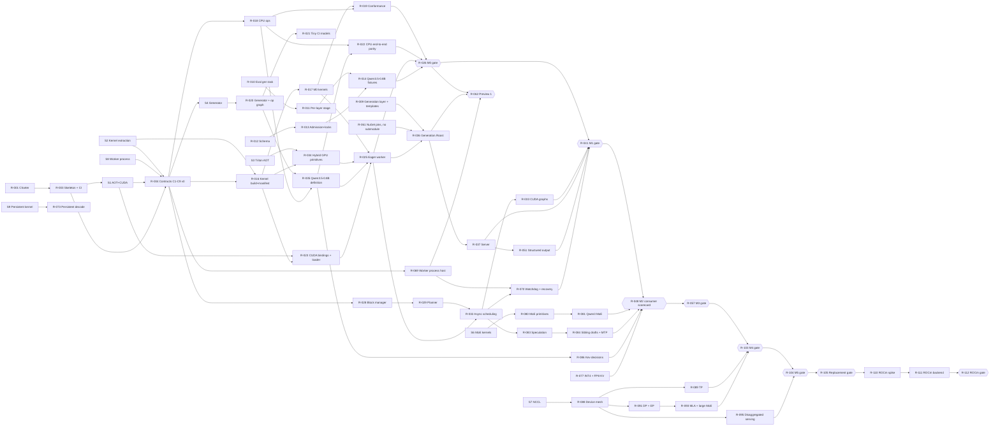

# Roost build plan

## Parallel work streams from the Roost PRD to a full vLLM replacement

Source: Roost PRD (2026-10-12, Mark). Written 2026-10-13, revised 2026-10-17. Status: proposed, for maintainer review. This document turns the PRD into work that agents and engineers can run in parallel. Roost lives in its own repository, `starlinghq/roost`. That replaces the PRD's "roost/ in the Starling monorepo" decision: Roost uses Starling but is a separate product, as `starlinghq/tokenizers` is. **Boundary (decided by the maintainer, 2026-10-18):** Starling works out the models; Roost runs on top of Starling in its own repository and consumes Starling's published NuGet packages, and nothing else. Roost makes no changes to `starlinghq/starling` and owns its own charter, decision log, evidence pipeline, profiles, fixtures and tolerances (section 2.2).

**Goal (decision 18, set by the maintainer on 2026-10-17, confirmed 2026-10-18).** Roost is a whole and complete replacement for vLLM, without compromises: every vLLM serving capability in the parity matrix (section 13) on NVIDIA GPUs, at or above vLLM on a published scorecard (section 14.3), and faster and better than vLLM in the categories section 14 names, with fidelity evidence vLLM does not publish and a fault model vLLM does not have. Multi-LoRA and user control over the kernels that run a model are first-class goals, with room for them in the contracts from C0. Nothing vLLM serves on NVIDIA is excluded; vLLM's Python extension points and Ray are covered by .NET and native equivalents (section 13.2). Whether the replacement also covers vLLM's non-NVIDIA backends is decision 29.

An adversarial review of this plan and the PRD is in `docs/plan/review.md`; its applied changes are folded in below and its product-direction changes are decisions 11 to 15 in section 11. A second review, against the replacement goal, is in `docs/plan/review-2.md`; its applied changes are folded in and its decisions are 18 to 28. Decision 29 was added on 2026-10-18 when the maintainer confirmed the goal, and decision 30 with the NuGet-only boundary (section 2.2).

The Starling facts were re-checked on 2026-10-16 against `main` at `9a5c143` and the local toolkit. Section 2.1 records what changed; decisions 16 and 17 are new.

This document does not restate the PRD's design. It states what is built, in which order, by whom, against which contract, and what each piece of work needs (GPU, review hours, decisions). Where Starling's code today differs from what the PRD assumes, section 2 records the difference and the plan follows the code. Where this plan compares Roost with vLLM, the baseline is [vLLM v0.31.0](https://github.com/vllm-project/vllm/releases) (released 2026-10-05), and every comparison is a hypothesis until the scorecard harness (R-047) has measured it.

## 1. Summary

Roost has four kinds of work with very different constraints:

1. **Host work that needs no GPU**: engine core, CPU reference ops, model compiler and op graph, frontend, Roost's evaluator and reference runners. It can run on hosted CI and cloud agent sessions, and is limited only by review capacity.
2. **Single-GPU work**: kernel library, worker, parity runs, the acceleration work in section 14. It is limited by two shared local GPUs, the 40 GPU-hour monthly cap and one scarce skill (CUDA). This is the critical path to M3.
3. **Multi-GPU work** (from M4): tensor, pipeline, data and expert parallelism, disaggregated serving, multi-node. The local GPUs differ in SM and have no NVLink, so this work runs only on rented multi-GPU pods (decision 20) and needs a distributed-systems role (decision 19). This is the critical path from M4 to M6.
4. **Evidence foundations (PRD P0, revised 2026-10-18)**: Roost's own generation layer (decode loop pieces and chat templates), evaluator, per-layer reference capture, profile manifests, admissions, locks and fixtures. They live in `starlinghq/roost` (section 2.2); none of them changes Starling.

**Languages.** Everything host-side is .NET. GPU kernels are CUDA C++ (vendored upstream code, CUTLASS and CuTe C++ templates, and Roost's own kernels) behind the C ABI (contract C1), and from M7 HIP C++ for ROCm (decision 29). ONNX Runtime is allowed in the host process and never loaded in the GPU worker process (decision 30). Rust is allowed for host-side native libraries behind the same style of C ABI: the structured-output engine (llguidance), the KV transport and, if S6 recommends it, the host expert kernels (decision 22). Python is never in the runtime or the image. It runs at build time only (`kernels/aot/`, Triton, until decision 23 retires it) and at test and tool time only (`evidence/pipeline/`).

The plan makes the host, single-GPU and library streams run concurrently instead of in sequence. The PRD runs P0 strictly before M0. Here P0 runs beside the start of M0, because only the M0 parity gate needs P0's evaluator and fixtures; the kernel library, CPU reference backend and model compiler do not. The PRD's own risk table already allows this ("M0 starts the kernel library and CPU backend, which need no evaluator"). Making it the default takes P0 (3 weeks, or 6 at recorded capacity) off the critical path.

Two mechanisms make the parallelism safe:

- **A contract freeze (C0)** in the first weeks: the C ABI header with its kernel registration table, the step plan and step result layouts, the op vocabulary and op graph, the state-group descriptor, the engine/frontend request types, the kernel manifest schema, the worker transport and the device mesh. They are merged as compiling stubs before any stream builds against them, frozen as **v0** once the S1, S2 and S8 spike reports are in, and promoted to **v1** at the M0 gate. After C0, a stream only meets another stream at a contract, never inside another stream's code.
- **Disjoint path ownership (section 4)**: every stream owns its directories. An agent never edits a path another stream owns. Cross-stream changes go through a contract-change PR owned by the integration stream (A).

The scarce resources are maintainer review hours (20 a week recorded), GPU time and two skills (CUDA kernels, distributed GPU systems), not agents. Section 9 sets work-in-progress limits from them. At recorded capacity the plan is schedulable to M3; M4 to M6 are not schedulable without decision 19.

**Release sequence.** The first thing anyone outside the project can use is **Preview 1** (R-062), straight after the M0 gate: preview NuGet packages that run Qwen3 on an NVIDIA card from C# behind `IChatClient`, in a worker process by default (decision 21), with greedy parity evidence and every unbuilt capability marked `unsupported`. M1 adds the server with tool calling and structured output; M2 adds the production profile, single-GPU MoE, speculative decoding, INT4 and the first scorecard gate on consumer cards; M3 covers onboarding, multi-LoRA and kernel control; M4 adds parallelism and large MoE; M5 adds disaggregation, KV tiers, multimodal input and long context; **M6 is the replacement gate** (R-105): every parity-matrix row `supported` or recorded as excluded, and the datacenter scorecard published.

**Where Roost expects to be faster.** Vendored kernels give parity, not a lead. Roost's lead has to come from what a generic Python engine does not do: model-specific compilation of a known catalogue, persistent decode kernels at low batch, exact hybrid prefix caching and state forks for the Qwen3.5 family, decision serving for Kev, dynamic CPU–GPU expert placement for MoE on consumer cards, evidence-chosen precision, and transparent recovery from worker faults. Section 14 lists each as a bet with the metric it must move and the result that kills it.

## 2. Starling facts that adjust the PRD


Checked against `starlinghq/starling` `main` at `fb27658` and nuget.org on 2026-10-13.

| PRD statement | Starling today | Consequence for this plan |
| --- | --- | --- |
| Repository: `roost/` in the Starling monorepo, project references until the packages are on nuget.org | Superseded: Roost is `starlinghq/roost` (private until the licence review). Of the packages Roost needs, only `Starlings.Tokenizers` (0.3.0-preview.1) is on nuget.org; `Starlings.Acquisition` and the generation packages are not published | Roost consumes Starling through a git submodule pinned by full SHA until the packages are published, then by exact package pins (section 3.1). R-061 publishes them. |
| Packages carry the `Starling` prefix (`Starling.Generation`, `Starling.Generation.Roost`) | The settled prefix is `Starlings` (`docs/kickoff.md`); every project is `Starlings.*` | Packages are `Starlings.Generation`, `Starlings.Generation.Roost` and `Starlings.Roost.*`. The org is `starlinghq` on GitHub and `Starlinghq` on Hugging Face. |
| The tokenizer is a library component in the monorepo | `Starlings.Tokenizers` is released from `starlinghq/tokenizers` and pinned exactly in `ai-dotnet/Directory.Packages.props` | Any new tokenizer profile is a tokenizers-repo release followed by a pin raise, never a change in Roost. Roost pins `Starlings.Tokenizers` from nuget.org exactly. |
| The decode loop and backend contract exist and "move into Starling.Generation" | The decode loop lives in `ai-dotnet/src/Starlings.Generation.OnnxGenAI/` (`TextGenerator.cs`, `StopSequenceMatcher.cs`, `IncrementalDetokenizer.cs`) and is coupled to GenAI types. There is no abstractions package. Consumers: `Models.Qwen35`, `Models.QwenChat`, `Models.Qwen35.Extensions.AI` | The extraction is real refactoring of a released package (0.1.0-preview.5) with two consumers, not a move. It is R-009, with an unchanged-evidence acceptance criterion. |
| Roost reuses the library's chat templates | `Qwen35ChatTemplate` and `QwenChatTemplate` live in `Models.Qwen35` and `Models.QwenChat`, which reference `Generation.OnnxGenAI` and so bring `Microsoft.ML.OnnxRuntimeGenAI.Managed` | R-009 also moves the template renderers and chat profiles into a package whose dependency closure has no `Microsoft.ML.OnnxRuntime*`. A Roost boundary check (R-003) keeps it that way. This is the largest P0 item. |
| The evaluator is "extended with a generation task" | There is no generation task or per-layer stage. A format v3 generation spec exists in `docs/evidence/p016-qwen35/README.md` section 10, plus a development-only evaluator (`evaluate_generation_candidate.py`) | R-010 builds format v3 from that spec. R-011 adds the per-layer stage and the hook capture in the reference runner. |
| The near-tie bound for "the current fp16x profile" is 0.015 | 0.015 is the margin observed in the fp16x divergences. The protected `ortgenai-fp32x-cuda` tolerance uses `exact_except_listed_margin_below_1e-3`, and the proposed fp16x rule uses 0.05 | The bound is a per-profile protected value that the maintainer sets in R-014 and R-015. The plan assumes no number. |
| M0 model Qwen3-1.7B: tokenizer "already covered" | `Models.QwenChat` and the `qwen3` candidate cover Qwen3-0.6B (CPU fp32, template `qwen3-text-v1`). There is no 1.7B admission, lock or fixtures | R-013 admits Qwen3-1.7B and verifies that its `tokenizer.json` and template digests match the 0.6B profile. If they differ, a tokenizer-repo profile is added first. |
| The benchmark harness is reused for serving load | `starlings-bench-raw/1` exists, but the harness is encoder-only (`Benchmarks.E5Harness`) | R-047 adds a generation `kind` to the raw schema and a serving-load harness. |
| Manifests carry the Roost profile fields | `model-manifest.schema.json` has no field for kernel revision, GPU or SM, driver, KV dtype or attention backend (the Qwen manifest notes this gap) | R-012 extends the schema before any Roost manifest is written. |
| Native AOT host | No project in the repository sets `PublishAot` or `IsAotCompatible` | AOT is unproven here. Spike S1 (R-005) qualifies it with CUDA interop and ASP.NET before anything depends on it. |
| Build targets SM 86, 89 and 90 in V1 | Not a Starling fact, but the first plan draft built SM 86 and 89 only | SM 90 is built from R-016 by a build-only CI job (nvcc needs no GPU); it is validated on rented hardware by R-102 (revised 2026-10-17). The SM list is a manifest field, and an SM without hardware evidence is `untested`. |
| Charter amendment needed | `.github/CHARTER.md` line 13 puts "distributed serving" and "bespoke GPU kernels" out of scope | The organisation charter lives in `starlinghq/starling`, so R-001 is a PR there. No Roost code merges before it. |
| "Agent-instructions row" | Starling's agent rules are in its `CLAUDE.md` (Layout list, Commands, Bounded authority) | Roost gets its own `CLAUDE.md` in R-003, carrying Starling's bounded-authority rules plus the Roost ones (kernel SHAs, no Python under `src/`, GPU leasing). Starling's `CLAUDE.md` gains one line pointing at Roost. |

### 2.1 Re-check on 2026-10-16

Checked against `starlinghq/starling` `main` at `9a5c143` (#87) and the local development host. Rows above that these supersede are corrected in place where they drive a backlog item.

| Area | Then (`fb27658`, 2026-10-13) | Now (`9a5c143`, 2026-10-16) | Consequence |
| --- | --- | --- | --- |
| Published packages | Only `Starlings.Tokenizers` on nuget.org | All 13 ai-dotnet packages in `docs/releases/ai-0.1.0-preview.6.md` are on nuget.org at `0.1.0-preview.6`, **including `Starlings.Acquisition`**. `Starlings.Models.QwenChat` is not yet published. Kickoff sets the next ai-dotnet version to `0.2.0` with no suffix; maturity is per profile, not a package label | Roost pins `Starlings.Acquisition` from nuget.org from the start. R-061 shrinks to `Starlings.Generation` and the template package, released in the ai-dotnet release train (`0.2.0` or a later preview), not as a separate preview set |
| Generation contract (R-009) | Not started | Unchanged: no `Starlings.Generation`; `TextGenerator`, `StopSequenceMatcher` and `IncrementalDetokenizer` still in `Generation.OnnxGenAI`; templates still in `Models.Qwen35` and `Models.QwenChat` (both reference `Generation.OnnxGenAI`) | R-009 remains the largest P0 item. Its release must fit the `0.2.0` train: either before it, or the extraction keeps type forwarders through it |
| Generation evaluation (R-010) | Development-only `evaluate_generation_candidate.py` | `model-pipeline/src/model_pipeline/evaluate_generation.py` evaluates generation with its own `starlings.generation-fixture` v1 format and stages `tokenizer`, `dotnet-ids`, `dotnet-text`. `stage-results.schema.json` still accepts format 1 and 2 only | R-010 builds format v3 over `evaluate_generation.py` and converts `starlings.generation-fixture` v1, rather than starting from the candidate script |
| Manifest schema (R-012) | No Roost fields | Unchanged | No change |
| Qwen3-0.6B | Assumed admitted (decision 15) | A `proposed` five-model onboarding candidate (`model-pipeline/candidates/qwen3/profile.json`); not in `registry/`, no file in `admissions/`, though `FIVE_MODELS.md` and the QwenChat README call it admitted. Qwen3-1.7B appears nowhere | Decision 15's premise is weaker: 0.6B still needs a registry entry and admission record before it can carry an M0 gate, so the saving over 1.7B is smaller than review finding 9 says (see the decision text) |
| Charter (R-001) | Out of scope: distributed serving, bespoke GPU kernels | Unchanged; nothing in starling names Roost | R-001, R-002 and R-059 are still the first starling PRs |
| GPU time | Local only, "no paid cloud GPU", 40 GPU-hours a month (kickoff, provisional) | CUDA qualification runs on RunPod secure-cloud RTX 3090 pods (`qualification.yml` job `cuda (runpod)`, `tools/ci/runpod.py`, balance floor and backstop timeout). Kickoff's budget row still says "no paid cloud GPU"; no RunPod budget is recorded | Decision 16. If Roost may use RunPod, parity and gate runs on SM 86 need not compete with local development time, and the week-6 checkpoint (section 7.2) changes |
| CUDA toolkit | Implicitly CUDA 12 (library names `libcudart.so.12`, `cudart64_12.dll`; cuBLASLt sizes) | The development host has CUDA 13.3 (nvcc 13.3.73, driver 610.57). SM 86, 89 and 90 remain supported by CUDA 13 | Decision 17. S1 and S2 run against 13.3 unless the maintainer pins 12.x; R-023's per-OS resolver takes the major version from the manifest rather than hard-coding 12 |
| Local devices | RTX 3090 and RTX 4060 Ti, shared | Unchanged. The 4060 Ti is often near full (15.5 of 16 GB in use on 2026-10-16), so `gpu-lease`'s free-memory check matters from the first spike | No change; S1 and S2 may need the 3090 when the 4060 Ti is occupied |
| SDK | Starling and tokenizers pin `10.0.100` | This host has only `10.0.401`, which a `10.0.100` pin does not resolve to | Roost pins `10.0.401` with `latestPatch` (R-003) |

### 2.2 NuGet-only boundary (2026-10-18)

The maintainer set the boundary: Starling works out the models, and Roost consumes Starling's published NuGet packages, and nothing else. This supersedes every row above, and every part of sections 3.1 and 4, that has Roost change Starling or read Starling's repository.

| Before (2026-10-17) | Now | Consequence |
| --- | --- | --- |
| R-001, R-002 and R-059 are PRs to Starling's charter, kickoff and `CLAUDE.md` | Roost has its own charter (`.github/CHARTER.md`) and decision log (`docs/kickoff.md`) | R-001 and R-002 are Roost changes; R-059 is a line in Roost's README. Starling's charter is not amended |
| Streams B1–B3 extract `Starlings.Generation`, extend `model-pipeline` and add Roost profiles to Starling's registry | Streams B1–B3 build Roost's own generation layer, evaluator and profiles under `src/Starlings.Roost.Generation/` and `evidence/` | R-009 to R-015 and R-061 are repurposed with the same IDs (section 10) |
| `external/starling` submodule supplies project references and `model-pipeline` | Exact NuGet pins only | R-061 removes the submodule and its CI checkout |
| Roost profiles, fixtures and tolerances in Starling's `registry/` and `protected/` (decision 4 open) | Roost's `evidence/registry/` and maintainer-only `evidence/protected/` | Decision 4 is settled; a profile change touches one repository |
| The generation contract and Qwen chat templates come from Starling (R-009) | They ship inside `Starlings.Generation.OnnxGenAI` and `Starlings.Models.Qwen35` (0.2.0 on nuget.org), which bring ONNX Runtime GenAI; `Starlings.Models.QwenChat` (the Qwen3 template) is not published | Decision 30 (decided 2026-10-18): ONNX Runtime is allowed in host-process packages, so Roost uses Starling's published public classes directly and implements only what is internal or unpublished |

Starling's published packages that Roost uses: `Starlings.Tokenizers` and `Starlings.Acquisition`; `Starlings.Generation.OnnxGenAI` and `Starlings.Models.Qwen35` in the host-side generation layer (decision 30); and Starling's ONNX model packages in `Server` (pooling routes, R-052). `Starlings.Models.QwenChat` and `Starlings.Models.Kev` are not yet published; the plan expects Starling to publish them (requested in [starling#124](https://github.com/starlinghq/starling/issues/124), 2026-10-18) and consumes them when it does. Designs that Starling has published, such as the format v3 generation spec, may be followed; Starling source is not copied into Roost.

## 3. Repository layout

**Why build an engine rather than a host over an existing runtime.** llama.cpp and ONNX Runtime GenAI already run on CUDA, Windows and consumer GPUs. Roost's product is fidelity evidence and a host-owned scheduler: neither runtime exposes typed, paged state groups or a step plan the host controls, llama.cpp's numerics are not referenced against transformers fp32, and Starling already ships ONNX Runtime GenAI for the in-process path and recorded where it diverges. The op-level `IRoostOps` boundary keeps a second backend (Vulkan, ROCm) possible later. Reopen this only with new evidence.

**Windows stays open.** Windows x64 is `untested` in V1 (PRD), but nothing may close it: no POSIX types in the C ABI, the kernel library's CMake builds with MSVC in CI (build only), and the loader resolves library names per OS. WSL2 is documented from Preview 1 and stays `untested` until someone with a Windows host runs the R-062 drill.

`starlinghq/roost` has its own solution, central package file, CI, release workflow and provenance files, following `starlinghq/tokenizers`. It copies Starling's root build conventions (`net10.0`, `TreatWarningsAsErrors`, central and locked package versions, `global.json` SDK pin) rather than inheriting them.

```
starlinghq/roost
  Roost.slnx
  Directory.Build.props  Directory.Packages.props  global.json   # same conventions as starling
  CLAUDE.md  AGENTS.md  README.md  THIRD-PARTY-NOTICES.md  PROVENANCE.md
  external/starling/                  # git submodule from R-003; removed by R-061 (section 2.2)
  .github/workflows/                  # ci.yml (hosted, CPU), release.yml (kernel assets, native libraries, packages, image)
  kernels/                            # CUDA C++, CMake; never in Roost.slnx
    include/roost_kernels.h           # the C ABI and registration table (contract C1)
    include/roost_worker_shm.h        # C2 step plan and result, C8 shared-memory records; offsets and handles only (R-004)
    manifest.toml                     # upstreams, SHAs, patch sets, ops, variants, specialisations, digests (C5)
    upstream/<name>.patches/          # patch sets only; sources fetched by SHA at build time
    src/ops/                          # C ABI wrappers, one file per op family
    src/fused/                        # fused ops lowered from the op graph (stream L)
    src/persistent/                   # persistent decode kernels per profile (stream L)
    src/collectives/                  # custom all-reduce and all-to-all (stream K)
    aot/                              # Triton AOT build scripts (build-time Python only; decision 23)
    CMakeLists.txt
  native/                             # Rust crates behind a C ABI (decision 22); cargo, locked; never in Roost.slnx
    roost-grammar/                    # llguidance token masks (R-051)
    roost-kvx/                        # KV block transport between processes and hosts (R-095)
  src/
    Starlings.Roost.Abstractions/     # StepPlan, StepResult, StateGroupDescriptor, Request, TokenEvent, RoostError, mesh (C2, C4, C6, C9)
    Starlings.Roost.Ops/              # op vocabulary (C3) + CPU reference backend
    Starlings.Roost.Graph/            # op graph (C7) and its passes: fusion, sharding, variant selection, persistent lowering (netstandard2.0)
    Starlings.Roost.ModelCompiler/    # Roslyn incremental source generator (netstandard2.0); builds the C7 graph, lowers to Forward<TOps>
    Starlings.Roost.Models.Qwen3/     # model definitions, one project per family
    Starlings.Roost.Models.Qwen3Moe/
    Starlings.Roost.Models.Qwen35/
    Starlings.Roost.Models.Kev/       # Qwen3.5 backbone + pointer head, decision serving (R-086)
    Starlings.Roost.Cuda/             # bindings generated from pinned CUDA, cuBLASLt, NVML and NCCL headers
    Starlings.Roost.Kernels/          # kernel library loader, registration table, digest check, variant selector, CUDA ops backend
    Starlings.Roost.Native/           # loader and bindings for the native/ Rust libraries
    Starlings.Roost.Engine/           # scheduler, block manager, prefix cache, speculation, rings, admission
    Starlings.Roost.Worker/           # device allocator, streams, graphs, weight streaming, sampler launch
    Starlings.Roost.WorkerHost/       # the per-GPU worker process: transport, handshake, heartbeat (C8)
    Starlings.Roost.Distributed/      # device mesh, rank bootstrap, launcher, KV transfer orchestration (C9)
    Starlings.Roost.Server/           # ASP.NET Core host, OpenAI and compatibility routes; publishes the `roost` binary
    Starlings.Roost.Generation/       # decode loop pieces (stop matching, incremental detokenisation) and chat templates (B1, decision 30)
    Starlings.Generation.Roost/       # in-process IChatClient API; drives a worker process by default
  tests/
    Starlings.Roost.*.Tests/          # CPU, in Roost.slnx, run in CI
    Starlings.Roost.*.Tests.Cuda/     # local only, not in Roost.slnx (as in ai-dotnet)
    Starlings.Roost.Conformance/      # kernel conformance runner (CPU half runs in CI)
  benchmarks/                         # scorecard harness (R-047) and workloads (section 14.3)
  evidence/                           # Roost's evidence pipeline (section 2.2); never in the runtime or image
    pipeline/                         # evaluator, reference runners, calibration (test- and tool-time Python, stream B2)
    schemas/                          # profile manifest and stage-results schemas (B2, B3)
    registry/                         # profile manifests, admissions and asset locks (B3)
    protected/                        # fixtures and tolerances; maintainer-only
  spikes/<spike-id>/                  # spike code: throwaway evidence, never in Roost.slnx; build-time Python allowed
  docs/m0/                            # spike reports (roost-<spike-id>-<topic>.md) and M0 reports
  tools/
    gpu-lease                         # device lock, free-memory check, GPU-hour ledger (section 8)
    generate-cuda-bindings.py         # same pattern as starling's tools/generate-ffmpeg-bindings.py
```

The worker-side closure check in `tools/check-roost-boundaries.py` (R-003, revised 2026-10-18) fails on any `Microsoft.ML.OnnxRuntime*` package in a package that runs in or is compiled into the GPU worker process: `Abstractions`, `Ops`, `Graph`, `Worker`, `WorkerHost`, `Kernels`, `Cuda`, `Native`, `Distributed`, `Models.*`. Host-process packages (`Engine`, `Generation`, `Generation.Roost`, `Server`) may use ONNX Runtime (decision 30). The in-process transport (C8) is for tests only and never loads ONNX Runtime. Rust crates follow the same binary rule as kernels: source and `Cargo.lock` in Git, built libraries as release assets only.

No Roost work lands in `starlinghq/starling` (section 2.2). `evidence/protected/` is maintainer-only, as Starling's `protected/` is.

### 3.1 How Roost consumes Starling

Revised 2026-10-18 (section 2.2): through published NuGet packages, pinned exactly in `Directory.Packages.props` and restored in locked mode, and nothing else.

| Starling package | Used by Roost in | Notes |
| --- | --- | --- |
| `Starlings.Tokenizers` | Engine and generation layer | Exact pin from nuget.org; a new tokenizer profile is a Starling release followed by a pin raise |
| `Starlings.Acquisition` | Weight, kernel and adapter fetching with digest verification | Exact pin; published at `0.1.0-preview.6` (section 2.1) |
| Starling's ONNX model packages (E5, EmbeddingGemma 2, GLiNER2) | `Server` only, for the pooling routes (R-052) and co-scheduling (R-087) | The engine closure check keeps ONNX Runtime out of every engine package |
| `Starlings.Generation.OnnxGenAI`, `Starlings.Models.Qwen35` (0.3.0) | Host-side generation layer (R-009): `IncrementalDetokenizer` and `Qwen35ChatTemplate` are public and used directly; `StopSequenceMatcher` is public from 0.3.0 (starling#124) and backs `StarlingStopMatcherFactory` | ONNX Runtime GenAI comes with them; allowed in host-process packages only (decision 30) |
| `Starlings.Models.QwenChat`, `Starlings.Models.Kev` (0.3.0, not yet pinned) | The Qwen3 template (R-009; first used by the Qwen3-1.7B profile, R-015) and the Kev reference (R-086) | On nuget.org since ai-dotnet 0.3.0 (2026-10-19, [starling#124](https://github.com/starlinghq/starling/issues/124)), with Experimental profiles only. Roost does not pin them yet: M0 and Preview 1 run on Qwen3.5-0.8B with `Qwen35ChatTemplate` (decision 15). The pins are added when R-015 or R-086 starts; the section 12 risk is closed |

Starling's `model-pipeline`, registry, protected fixtures and evaluator are not used. Roost's evidence pipeline lives in `evidence/` (streams B2 and B3), and a Roost profile change touches only this repository.

These design choices are fixed here because every stream depends on them.

- **Backend dispatch by static abstract interface.** The op vocabulary is an interface with static abstract members (`interface IRoostOps { static abstract void RmsNorm(in RmsNormArgs a); … }`). The generator emits `Forward<TOps>() where TOps : struct, IRoostOps`. `CpuOps` (stream D) and `CudaOps` (stream F) are structs that implement it. Generic instantiations over structs are specialised and devirtualised by both the JIT and Native AOT, so the same generated forward runs on the CPU reference in CI and on the GPU with no interface dispatch or allocation, whether or not the host is AOT-published. AOT is a property of the `roost` binary, never a requirement on the library packages: most ASP.NET services that would host Roost in-process are not AOT. This is what lets streams D, E and F proceed independently: E only needs the interface, not a backend.
- **Compile time knows only the op vocabulary.** The generator checks a definition against C3 and nothing else. Whether a kernel specialisation exists for a dtype, head size or SM is a startup check (R-023), because kernels ship and update separately from managed packages. `Starlings.Roost.Models.*` ship pre-generated forwards, so someone consuming a model package never runs the generator. Someone defining a new model (G6, R-055) references `Starlings.Roost.ModelCompiler` as an analyzer package that depends on C3 only; no build ever reads `kernels/manifest.toml`.
- **Generated CUDA bindings, not a binding package.** `Starlings.Roost.Cuda` is generated from the pinned CUDA toolkit headers by a repository script, following the precedent `tools/generate-ffmpeg-bindings.py`. This keeps the dependency surface pinned and reviewable, and it keeps third-party binding licences out.
- **The forward is a graph before it is code.** The generator first builds a typed op graph (C7) from the model definition: C3 ops with shapes, dtypes and, from M4, sharding annotations. Passes over that graph fuse ops, insert collectives for tensor and expert parallelism, choose kernel variants, and lower a whole decode step to a persistent kernel where a profile has one. The result is lowered to `Forward<TOps>()`. `CpuOps` always runs the unfused reference graph, so every fused, sharded or persistent form is checked against the same reference.
- **Kernels register; they are not looked up by name.** A kernel library exports a registration table (C1) of entries `(op, variant, constraints, entry point)`, and more than one library may load: the base library, the persistent kernels for a profile, and a user's library. The selector (R-072) picks a variant per shape bucket and SM, from conformance-passed variants only, and a profile's evidence names the variant digests actually selected.
- **One worker process per GPU.** The engine, frontend and queues live in the host process; each GPU is driven by a worker process (C8) that reads plans from and writes results to rings in shared memory. A sticky CUDA fault or a missed step deadline kills only that worker, and the engine respawns it and resumes its requests (R-070). In-process mode remains for tests and development.

## 4. Streams and ownership

Each stream owns its paths and its backlog items (section 10). Every path is in `starlinghq/roost` (section 2.2). A project's test projects, `tests/<Project>.Tests/` and `tests/<Project>.Tests.Cuda/`, belong to the stream that owns the project, and each stream may add its own projects' lines to `Roost.slnx` and its own package versions to `Directory.Packages.props` (clarified 2026-10-18). An agent works in its own worktree, on one item at a time, and opens a draft PR. "Needs GPU" means at least one acceptance criterion needs a GPU run with committed evidence; "multi" means a multi-GPU pod.

| Stream | Scope | Owns | Needs GPU | Best owner |
| --- | --- | --- | --- | --- |
| **A. Integration and contracts** | Charter and decision log; repository skeleton, CI, release workflow, boundary checks; NuGet pins and their raises; contracts C1–C9 and every later contract change; gate assembly; release drill | Root build files, `Roost.slnx`, `CLAUDE.md`, `AGENTS.md`, `.github/` (including `CHARTER.md`), `docs/kickoff.md`, `external/` until R-061, `src/Starlings.Roost.Abstractions/`, `kernels/include/`, `tools/` | No | Primary agent; maintainer approves |
| **B1. Generation layer** | Roost's decode loop pieces (stop matching, incremental detokenisation) and chat templates, behind `Starlings.Generation.Roost` (decision 30) | `src/Starlings.Roost.Generation/` | No | Workhorse agent |
| **B2. Evaluator** | Roost's evaluator with the generation task (format v3) and per-layer stage; transformers reference runners with hook capture; calibration for evidence-chosen precision | `evidence/pipeline/`, `evidence/schemas/stage-results.schema.json` | No | Workhorse agent |
| **B3. Profiles and fixtures** | Roost profile manifest schema; model admissions and locks (Qwen3, Qwen3 MoE, Qwen3.5, Kev, the M4 large MoE, audio and GGUF profiles); safetensors locks; proposed reference fixtures | `evidence/schemas/profile-manifest.schema.json`, `evidence/registry/`; proposals for `evidence/protected/`; run artifacts outside Git | No (fp32 CPU references; large MoE references on rented CPU hosts) | Small-model agent; maintainer sets tolerances |
| **C. Kernel library** | CMake build, vendoring by SHA, patch sets, C ABI wrappers and registration, MoE and quantised kernels, Triton AOT and its retirement, manifest, provenance check, digests, release assets | `kernels/` except `include/`, `src/fused/`, `src/persistent/` and `src/collectives/` | Yes | CUDA engineer plus agents |
| **D. CPU reference and conformance** | `CpuOps` in double precision for every op (bf16 weights upcast per op); conformance runner with `compute-sanitizer`; goldens; per-op-class tolerance files (proposed) | `src/Starlings.Roost.Ops/`, `tests/Starlings.Roost.Conformance/` | Only for the GPU half of conformance | Workhorse agent |
| **E. Model compiler and definitions** | Source generator and op graph builder; model definitions and weight maps; tiny CI models (dense, hybrid, MoE); inspect-to-definition mapping | `src/Starlings.Roost.ModelCompiler/`, `src/Starlings.Roost.Models.*/` | No (CPU end to end) | .NET engineer plus agents |
| **F. Worker** | CUDA bindings, kernel loader and selector, device allocator, streams, weight streaming, graphs, sampler, worker process, watchdog, recovery | `src/Starlings.Roost.Cuda/`, `…Kernels/`, `…Worker/`, `…WorkerHost/`, `…Native/` | Yes | CUDA engineer plus .NET performance engineer |
| **G. Engine core** | Rings, block manager, state groups and forks, prefix cache, planner, preemption, admission, speculation, expert placement, KV tiers; recorded-worker replay | `src/Starlings.Roost.Engine/` | No | .NET performance engineer plus agents |
| **H. Frontend and adapters** | `Starlings.Generation.Roost`; Server routes (OpenAI, Responses, Anthropic Messages, decision, pooling, admin); validation against the capability table; structured output and parsers; streaming; metrics; evidence route | `src/Starlings.Roost.Server/`, `src/Starlings.Generation.Roost/`, `native/roost-grammar/` | No | Agents, reusing the library |
| **I. Evidence and benchmarks** | Engine gate harnesses; API compatibility suite; scorecard harness and competitor runners; `roost-v1` onboarding plugin and recipes | `benchmarks/`, `tests/*Gates*`, `evidence/pipeline/onboarding/`, `evidence/recipes/` | Gate runs yes | Agents; maintainer reviews evidence |
| **J. Operations** (from M2) | AOT image, `roost doctor`, cold-start staging, RSS, soak, fault and co-tenant tests, sleep and wake, Kubernetes | `deploy/`, `tests/Starlings.Roost.Soak/` | Yes | Agents |
| **K. Distributed** (from C0 spike, M4 build) | Device mesh, NCCL bindings use, rank bootstrap, multi-node launcher, TP/PP/DP/EP, custom collectives, KV transfer, disaggregated serving | `src/Starlings.Roost.Distributed/`, `kernels/src/collectives/`, `native/roost-kvx/` | Yes (multi) | Distributed-systems engineer (decision 19) plus agents |
| **L. Acceleration** (from M1) | Op graph passes, fused kernels, persistent decode kernels, variant autotuning, the section 14 bets | `src/Starlings.Roost.Graph/`, `kernels/src/fused/`, `kernels/src/persistent/` | Yes | CUDA engineer (second CUDA role, decision 19) plus agents |

Spike code lives in `spikes/<spike-id>/` and spike reports in `docs/m0/`, both owned by the stream that runs the spike. Spike code is evidence, not product: it stays out of `Roost.slnx`, may use build-time Python, commits its raw run logs as text under `spikes/<spike-id>/results/`, and is never imported by a `src/` project. A spike's findings reach the product only through the backlog item that adopts them.

The contract files inside `src/Starlings.Roost.Ops/` (`IRoostOps` and its argument structs, C3) and `src/Starlings.Roost.Graph/` (the C7 graph, pass and checker types) belong to stream A, like everything else in C1–C9; the rest of each project belongs to streams D and L (R-004).

Streams C, F and L share the scarcest skill (CUDA). The plan keeps every other stream off those people: D, E, G and H are specified so they can be built and reviewed with .NET skills alone, against `CpuOps` and a recorded worker. K needs a different scarce skill and starts building only in M4, after its spike.

## 5. Contract freeze (C0)

Stream A writes these in weeks 1–3 as one ADR-style section in `README.md` plus compiling stubs and contract tests. They freeze as **v0** after the S1, S2 and S8 reports (R-004), and may change at the cost of a stream A PR until the M0 gate, where they are promoted to **v1** with whatever M0 taught. R-004 set `ContractVersion.Current` to 1 for v0 (`ContractVersion.Stage` is `"v0"`); the ADR in `README.md` records each difference from the table below. After v1, a field or signature changes only through a stream A PR that bumps the contract version and updates every consumer in the same change. Names reserved for later phases are declared in v0 so that adding them is never a layout change.

| Id | Contract | Content | Consumers | Lands in M0 as |
| --- | --- | --- | --- | --- |
| C1 | `roost_kernels.h`, ABI major 1, minor 0 | Status codes, `roost_abi_version()` returning major and minor, `roost_last_error()`. A library exports `roost_register(RoostOpTable*)`: one entry per (op, variant id, constraints on SM, dtype, shapes and layout, flags for graph-capturable, deterministic and batch-invariant, entry point, workspace query). Entry points take `(const Roost<Op>Params*, void* stream)`. Every params struct begins with `uint32_t struct_size` and `uint32_t abi_minor`; a library rejects a size it cannot read, and the loader accepts a library whose major is equal and whose minor is at least the caller's. More than one library may register; conflicts resolve by variant id. Fixed-width types only, no POSIX types, so the header compiles under MSVC. The Rust libraries in `native/` follow the same versioning and error rules with their own headers | C, F, L, K, D (signature mirror) | Header, registration table and the M0 op list. Later ops and variants are added; nothing is changed |
| C2 | `StepPlan` / `StepResult` v1 | Every PRD field from M0: sequence table (position offset, token count, block-table offsets per group, recurrent slot, LoRA slot, grammar slot, draft count, verify flag), flat ids and positions, sampling table, cache ops (copies, tier moves, snapshot writes, state-group forks), shape bucket, math mode, embedding input slot. Reserved from v0: speculation tree (parent indices and tree mask per sequence), MoE routing buffers (per-expert token counts, expert placement map), per-rank plan header (rank, mesh id), KV transfer ops (send and receive blocks to a peer), pooling and decision rows (rows that end in a head instead of the sampler), encoder-output slots for multimodal input. Result: ids, accepted drafts, finish flags, logprob rows, head outputs, device timings, expert load counts. Unmanaged, blittable structs over double buffers that live in shared memory (C8); the plan header carries a layout version so a field can be added without breaking the buffers | G writes, F reads | All fields present; fields not yet used stay zero and are asserted zero by F until their feature lands |
| C3 | Op vocabulary `IRoostOps` | Static abstract methods for RmsNorm, QkNorm, Rope (default, llama3), PagedAttention, SiluAndMul, GeluAndMul, Gemm, Embedding, LmHead, Residual, cache ops, Argmax/Sample. Reserved names: GatedDeltaRule, CausalConv1d, recurrent state ops and sliding-window attention (M1); RopeScaled (YaRN, longrope, dynamic NTK), Quantize, Dequantize, GemmW4A16, GemmFp8, TreeAttention, RejectSample (M2); MoeRouteTopK, MoePermute, MoeUnpermute, GroupedGemm, FusedMoe (M2); LoraShrink, LoraExpand (M3); AllReduce, AllGather, ReduceScatter, AllToAll, MlaAttention (M4); PatchEmbed, BidirectionalAttention, MelSpectrogram, AudioConvSubsample, DequantizeGguf (M5). Optional fused ops, each defined as its unfused parts so a backend that lacks it falls back: AddRmsNorm, AddRmsNormQuant, SiluMulQuant, QkvQkNormRopeCacheWrite, GemmLoraEpilogue. Argument structs carry dtype and layout; buffers are `DeviceSpan` (pointer, length, dtype); there is no tensor type | D, E, F, L | M0 methods implemented; later methods declared, throwing in `CpuOps` until their item lands |
| C4 | `StateGroupDescriptor`, `IBlockPool`, `IBlockTransfer` | Kind (full, sliding with window, recurrent with state shape, cross, draft, MLA latent, adapter, expert, encoder output), layers, per-layer KV heads and head size, block size, KV dtype per group, bytes per block, tier (device, host, disk, remote), sharding over the mesh (C9). Recurrent snapshots are their own pool, so a hybrid model's attention block size is never inflated to the recurrent state size. `Fork` (copy-on-write for paged groups, copy for recurrent state), `ExportBlocks` / `ImportBlocks` | E emits, G allocates, F and K read | One full-attention group for Qwen3; the recurrent, adapter and expert kinds are exercised by synthetic tests |
| C5 | `kernels/manifest.toml` schema | Upstreams (repo, full SHA, licence per file, patches, ops taken); the SM build list (80, 86, 89, 90, 100, 120) with a validation status per SM; ops with variants, constraints and binary digests; toolkit and minimum driver; Triton and Python versions for AOT; Rust crates with `Cargo.lock` digest | C writes; D (what to test), F (startup check), the release workflow and the provenance check read it. The model compiler does not | JSON Schema plus a validator in `tools` |
| C6 | `Request`, `TokenEvent`, `RoostError` | Ids, sampling params (including n, best_of, beam width), stop ids, grammar and response-format handles, tool and reasoning parser ids, LoRA handle, priority, deadline, speculation policy, multimodal parts, decision questions (Kev) and pooling inputs; per-request event channel with a `recovered` flag; typed error codes (InsufficientDeviceMemory, PromptTooLong, QueueFull, InvalidOption, DeviceFault, WorkerRestarted, AssetMismatch, ProfileUnsupported, Internal) and their stable HTTP body | H, G, B1's generation layer | Complete |
| C7 | Op graph | A typed DAG of C3 ops with shapes, dtypes, layouts and sharding annotations; pass interface (fusion, sharding, variant selection, persistent lowering); the lowering to `Forward<TOps>`; a rule that every pass output is checked op by op against the unfused graph on `CpuOps` | E builds, L and K write passes, D checks | Graph types, the identity lowering and the checker |
| C8 | Worker transport | Plan and result rings in a shared-memory segment registered with `cudaHostRegister` in the worker; spawn and handshake (ABI, manifest and weight digests, device, mesh rank); heartbeat; per-step deadline; fault classes (recoverable, sticky, hang); kill, respawn and resume rules; the in-process transport for tests | G, F, H | Both transports behind one interface |
| C9 | Device mesh | Ranks; TP, PP, DP and EP sizes; NCCL unique-id bootstrap; one worker process per GPU; per-rank plans; mesh descriptor in the profile manifest | G, F, K, E | Types and a single-rank mesh; multi-rank exercised by a CPU simulation in CI |

The profile manifest schema (R-012) and the evaluator format v3 (R-010) are contracts too; streams B3 and B2 own them in `evidence/schemas/`, and changes follow the same contract-version rule.

## 6. Spikes before commitments

Each spike is time-boxed, ends in a report under `docs/m0/roost-*.md` with numbers and an estimate, and follows the two-repair-attempts rule. S1, S2, S4 and S8 start in week 1 because the v0 freeze waits on S1, S2 and S8; S3, S6 and S10 start in week 1 because they are long-lead; S7, S9 and S11 start when their hardware or prerequisites exist.

| Spike | Question | Done when | Stop and escalate if | Gates |
| --- | --- | --- | --- | --- |
| **S1 (R-005)** Native AOT and CUDA interop | Can a Native AOT linux-x64 binary load generated CUDA bindings and a C ABI `.so`, launch a kernel, capture and replay a CUDA graph, and serve SSE from an AOT ASP.NET minimal API? What are the P/Invoke and replay overheads and the baseline RSS? | Report with p50 and p99 per-call overhead, graph replay latency, RSS split (CUDA context, kernel images, managed) on the 4060 Ti; a trimming warnings list | AOT trimming or native loading blocks after two attempts. In that case JIT stays the fallback, labelled (PRD risk row) | F, H, J; the PRD's open host RSS target; C0 v0 |
| **S2 (R-006)** Kernel extraction without torch | Which upstream provides each M0 op with no libtorch at build time? vLLM `csrc/` uses torch extension types (`at::Tensor`, `TORCH_CHECK`, op registration), so wrappers must be stripped or rewritten; FlashInfer's CUDA templates are largely framework-free. Gemm: cuBLASLt (redistributable, compute type pins the TF32 policy) or vendored CUTLASS? | Per op: upstream, SHA, patch-set size in lines, build time; one attention op running from a C ABI test on SM 86 and 89; a recommendation on Gemm | The patch set for one op exceeds about 300 lines, or FlashInfer cannot be built standalone | C, the C5 manifest content; C0 v0 |
| **S3 (R-007)** Triton AOT for Gated DeltaNet | Can the flash-linear-attention chunked and recurrent gated-delta-rule kernels used by vLLM be AOT-compiled to cubins per SM and specialisation, and called from the C ABI with output matching Python FLA? What would a CUDA C++ port cost (decision 23)? | Matrix size, build time and cubin bytes for the Qwen3.5-0.8B specialisations on SM 86 and 89; numerical diff against Python FLA; a port estimate | AOT is not possible for a needed kernel. In that case the CUDA C++ port becomes M1 new-primitive work, re-estimated | M1 (R-034); long lead, so it starts now |
| **S4 (R-008)** Source generator shape | Do static-abstract backend dispatch plus a Roslyn incremental generator over the C3 op vocabulary produce allocation-free code under both JIT and AOT, and a compile error naming a missing op? Can the generator build a C7 graph and lower it without losing either property? | A two-layer toy model generated through the graph and run on `CpuOps` under JIT and AOT with zero allocations; the missing-op diagnostic demonstrated; incremental build time measured | Generated code allocates or fails AOT analysis | E, C3, C7 |
| **S5** vLLM host gap (optional measurement) | How large is vLLM v0.31's decode host gap and low-batch step time for Qwen3-1.7B bf16 on the 3090? | Nsight Systems trace and a short note; labelled exploratory, not a claim | — | Bets X1 and X10 (section 14) |
| **S6 (R-063)** MoE kernels without torch | Which upstream provides fused MoE, grouped GEMM (bf16, FP8, INT4) and top-k routing with no libtorch: CUTLASS grouped GEMM, vLLM's CUDA MoE kernels, Marlin MoE? Can the host expert kernels for bet X6 be .NET `Vector512` code, or do they need Rust or C++? | Per op: upstream, SHA, patch size; one Qwen3 MoE layer from the C ABI on SM 86 matching `CpuOps`; host expert GEMV throughput on the development CPU for .NET and one native option | No upstream builds standalone for grouped GEMM after two attempts; then a CUTLASS-based kernel becomes new-primitive work | C, R-080, R-082 |
| **S7 (R-064)** NCCL from .NET | Can two worker processes on a rented 2-GPU NVLink pod bootstrap NCCL from .NET, run all-reduce from a captured CUDA graph, and how does NCCL compare with a custom one-shot all-reduce at decode sizes? | All-reduce latency by size, graph capture working, bootstrap time, a recommendation | NCCL cannot be captured in a graph from this process model | K, C9, R-088 |
| **S8 (R-065)** Worker process and shared-memory rings | What does the process boundary cost per step compared with in-process rings? How fast is kill, respawn, re-handshake and weight reload, and how do sticky faults and hangs present? | Per-step overhead p50 and p99, respawn time with weights in page cache, a fault-injection kernel showing sticky and hang cases detected | Overhead above 2% of a Qwen3-1.7B decode step at batch 1 that cannot be removed; then in-process becomes the default with the process as an option | F, C8, C0 v0, decision 21 |
| **S9 (R-066)** Persistent decode kernel | Does a persistent whole-step decode kernel for Qwen3-1.7B (bf16, batch 1–8) beat Roost's own graphed eager path on the 3090? [Cohere reported](https://cohere.com/blog/megakernels) 1.58x per decode step at batch 1 against vLLM v0.24 on H100 (2026-09-08), and [Mirage MPK](https://arxiv.org/abs/2512.22219) reports up to 1.7x lower latency; neither has been measured on SM 86 | Step-time ratio at batch 1, 4 and 8; register and shared-memory budget; build time; a go or no-go for R-073 | Below 1.2x at batch 1 after two attempts | L, R-073, bet X1 |
| **S10 (R-067)** Rust native library ABI | Can llguidance be built as a static or shared library behind a C ABI, loaded from AOT .NET, and compute a token mask for a JSON schema within the budget of a decode step? | Mask latency p50 and p99 per token for three schemas on Qwen3's vocabulary; AOT load working; build and licence notes | Mask latency above the batch-1 decode step on the 3090 with no overlap available | H, R-051, decision 22 |
| **S11 (R-068)** Green contexts for prefill and decode | Can CUDA green contexts, driven from .NET through the driver API, split SMs between prefill and decode streams on one GPU, and does that improve p99 inter-token latency over chunked prefill? | p99 ITL and throughput under a mixed load, with and without partitioning | No p99 gain at equal throughput | L, bet X8 |

## 7. Phases, critical path and what runs concurrently

### 7.1 Dependency graph (key items)



**Critical path to M0:** R-003 → S1, S2, S8 → R-004 → R-016 → R-017 → R-025 → R-026, with S3 → R-034 (the hybrid GPU primitives for Qwen3.5-0.8B, decision 15) beside R-017, all in streams A, C and F, all needing CUDA skill and GPU time; stream C carries both R-017 and R-034. Everything else (B, D, E, G, H) has slack against it, provided it is ready when R-025 lands.

**Critical path to M1:** R-025 → R-032 → R-033 (worker, F); the hybrid work moved into M0 with decision 15. F remains the bottleneck stream, which is why G and H start in M0 rather than M1.

**Critical path to M2:** S6 → R-080 → R-081 (MoE, C and E) beside R-083 → R-084 (speculation, G and F) and R-077 (INT4, C). C carries both MoE and INT4, so the second CUDA role (decision 19) is what makes M2's dates real.

**Critical path to M6:** S7 → R-088 → R-089 and R-091 → R-093 (stream K on rented pods), then R-095 and the datacenter scorecard. It cannot start building before decisions 19 and 20.

### 7.2 Phase plan

Weeks assume the engineering roles are filled: two CUDA engineers, a .NET performance engineer and, from M4, a distributed-systems engineer (decision 19). The second figure is recorded capacity (one maintainer at 20 hours a week, agents implementing), scaled as in the PRD. Weeks for M2 onward are estimates that the week-12 and M2 checkpoints re-baseline from the `gpu-lease` ledger and review throughput.

| Phase | Weeks (filled / recorded) | Streams active | Exit gate |
| --- | --- | --- | --- |
| **C0, contracts and spikes** | 1–3 / 1–5 | A (R-001 to R-004), spikes S1–S4, S6, S8, S10 (C, E, F, H), B1, B2 and B3 start | Charter amendment merged; contracts merged as v0 stubs after the S1, S2 and S8 reports; spike reports with go or no-go |
| **P0, evidence foundations** (concurrent with early M0) | 1–4 / 1–8 | B1, B2, B3 | Roost's evaluator reproduces a Qwen3 reference run end to end; Qwen3 fixtures proposed and tolerances set |
| **M0, first model (Qwen3.5-0.8B, hybrid)** | 3–9 / 5–18 (re-baselined at the capacity checkpoint) | C (M0 kernels and hybrid primitives), D (CPU references including recurrent ops), E, F (eager worker, worker process); G and H start against `CpuOps` and a recorded worker | PRD M0 gate (R-026); contracts promoted to v1 |
| **Preview 1** (R-062) | 9–10 / 18–20 | H (adapter), A (release), J (packaging, WSL2 doc) | Packages install from nuget.org into a clean consumer; Qwen3 runs through `IChatClient` in a worker process with the M0 evidence attached; capability table published |
| **Capacity checkpoint** | week 6 / week 12 | A | If the first CUDA role is unfilled, or the `gpu-lease` ledger shows M0 GPU use above twice the estimate, V1 narrows to Preview 1 plus the M1 server and the replacement dates move with decision 19. Recorded in kickoff either way |
| **M1, serving core, agents and first hybrid** | 9–17 / 17–34 | F (async, graphs, watchdog), G (finish), C and E (hybrid), H (server, structured output, parsers, compatibility routes), I (gates, scorecard harness), L (fusion passes, S9, S11) | PRD M1 gate plus structured output, tool calling and worker recovery (R-041) |
| **M2, production profile, MoE and speculation** | 16–28 / 32–54 | F (sampler, faults), C (FP8, INT4, MoE), E (Qwen3 MoE, Kev), G (speculation, NVML admission), L (persistent decode), J, I | Consumer-class scorecard against vLLM and SGLang (R-048) |
| **M3, coverage, onboarding, LoRA and kernel control** | 26–38 / 52–76 | E (Gemma 4), C, F and G (multi-LoRA, expert placement, variant selection, KV host tier), H (pooling routes), I (`roost-v1` recipes, onboarding trials), J (soak), B2 (evidence-chosen precision) | PRD M3 gate plus multi-LoRA and kernel candidates (R-057) |
| **M4, parallelism and large MoE** | 34–50 / not schedulable | K (mesh, TP, PP, DP, EP, multi-node), C (MLA, collectives), E (large MoE definition), B3 (large MoE admission) | TP and EP parity and scaling evidence (R-103) |
| **M5, disaggregation, KV tiers, multimodal and long context** | 46–60 / not schedulable | K (disaggregation, KV transfer), G (disk and remote tiers), E and H (vision and audio input), C (NVFP4, MXFP4, GGUF and AutoRound formats, 2-bit KV), J (sleep and wake, Kubernetes) | R-104 |
| **M6, replacement** | 58–66 / not schedulable | A, I, J, H (drop-in compatibility) | Every parity-matrix row `supported` or excluded; datacenter and consumer scorecards published (R-105) |
| **M7, ROCm** | after M6 / not schedulable | C (HIP kernels), F (HIP worker), D (conformance on ROCm), I (ROCm scorecard) | ROCm parity and scorecard (R-112) |

### 7.3 What starts early and why

- **G (engine core) starts in week 3.** It needs only C2, C4 and C8. It is tested against a recorded worker that replays `StepResult` sequences, and end to end against `CpuOps` on the tiny model. By the M0 gate the planner, block manager and prefix cache should already be green in CI, so M1 is mostly F integration.
- **H (frontend) starts in week 3** against a fake engine that satisfies C6. It uses B1's stop matching and incremental detokenisation, which follow the semantics of Starling's published generation packages. S10 runs in C0 so structured output can land in M1.
- **E proves the definition on the CPU before any GPU runs (R-022).** Qwen3 runs through the generated forward on `CpuOps` and is compared per layer with transformers fp32 hooks. Definition and weight-map errors are therefore found without GPU time, and the GPU worker is later compared against `CpuOps` op by op.
- **H's in-process adapter (R-036) lands in M0** against the eager worker, driving it through the worker process host (R-069), so Preview 1 ships as soon as the M0 gate passes. M1 then adds concurrency and graphs underneath an API that does not change.
- **The CI models.** `roost-tiny` is a Qwen3-shaped configuration with deterministic seeded random weights generated at test time (no weights in Git, as CI enforces); `roost-tiny-moe` and `roost-tiny-hybrid` follow in M1 and M2. CI gates on them are self-consistency gates (chunked vs one call, concurrent vs alone, preempted vs uninterrupted, speculative vs plain, forked vs fresh, TP-simulated vs single rank) on `CpuOps`. Fidelity against transformers runs locally with evidence.
- **K's spike (S7) runs in M1 on a rented pod**, so the mesh and C9 are proven long before M4, and C2's reserved per-rank fields are exercised by a CPU simulation from M0.

## 8. GPU time and devices

Both local GPUs are shared with other workloads, and the recorded budget is 40 GPU-hours a month with no paid cloud GPU. Starling now runs CUDA qualification on RunPod RTX 3090 pods (section 2.1); whether Roost may do the same, and within what budget, is decision 16, and decision 20 extends it to multi-GPU pods.

- **Device roles.** The RTX 4060 Ti (SM 89, 16 GB) is the development device for streams C, F and L. The RTX 3090 (SM 86, 24 GB) is the evidence device for conformance on SM 86, parity, engine gate runs and the consumer scorecard. Both SMs must pass conformance before M0 closes. An SM 120 card (decision 24) joins as the second consumer evidence device from M2. SM 80, 90 and 100 are compiled in CI from R-016 and validated on rented hardware (R-102); until then their status is `untested`.
- **Multi-GPU pods.** TP, PP, EP, multi-node and disaggregation evidence runs only on rented pods with NVLink (2 and 8 GPUs, SM 90 or 100), booked through the same ledger. The two local cards differ in SM and have no NVLink, so they never carry a multi-GPU claim.
- **`tools/gpu-lease`** (part of R-003): takes an exclusive lock per device, checks free memory via `nvidia-smi` against the job's declared need, exports `CUDA_VISIBLE_DEVICES`, and appends device, wall clock and stream to a ledger outside Git. Parallel agents cannot collide on a device, and the monthly budget is measured rather than guessed. Every GPU test project calls it, and rented pod time is appended to the same ledger.
- **Budget.** M0 GPU use is mostly short: conformance runs in minutes, and parity for a 1.7B model in minutes. Interactive kernel debugging is the unknown. The plan asks the maintainer to keep 40 hours for the first month, read the ledger at week 4, and decide then whether M0 and M1 need a higher cap. The acceleration work in M1 and M2 (S9, R-073, autotuning) is profiling-heavy and is expected to need more than 40 hours a month; the M2 checkpoint reads the ledger before committing to it. Multi-GPU hours for M4 to M6 are decision 20.

## 9. Review capacity and work-in-progress limits

With agents implementing, throughput is set by maintainer review, at 20 hours a week recorded.

- **Limit on open review load.** At recorded capacity, at most four draft PRs await maintainer review at once, and at most one of them is a contract PR (stream A) or a fixture or tolerance PR. A stream whose PR would exceed the limit continues on its next item locally, in its worktree, without opening a PR. With the roles filled, engineers review C, F, G, K and L among themselves, and the maintainer reviews contracts, fixtures, tolerances, evidence and gates only.
- **Active streams.** At recorded capacity, run at most four implementation streams at once, in this priority: the critical-path streams (C and F as one person's work, plus A), then E, D and B (M0 needs them), then G and H (they have slack). L and K do not run at recorded capacity. With the roles filled, all thirteen can be active.
- **PR size.** One backlog item per PR. Contract PRs contain only contracts, stubs and contract tests. Generated code is not reviewed line by line; the conformance suite and the parity bisection point at it when needed (PRD).
- **Code that always gets a human reviewer.** Concurrency and fault-handling code is where conformance and parity are weakest: R-027 (rings), R-028 (block manager and forks), R-032 (async scheduling), R-069 and R-070 (worker process, watchdog, recovery), R-083 (speculation) and R-088 to R-091 (mesh and parallelism). These PRs are reviewed by an engineer or the maintainer, never by a review agent alone, and carry deterministic replay tests plus `compute-sanitizer racecheck` stress runs.
- **What the maintainer must read.** The charter amendment, contracts C1–C9, the spike reports, the inspect report, parity reports, proposed tolerances, the scorecard method (section 14.3), and each gate's evidence. Everything else is reviewed by the owning engineer or an independent review agent before the maintainer sees it.

## 10. Backlog

IDs `R-001` onwards, tracked as issues in `starlinghq/roost` with `stream:<letter>` labels. Columns follow starling's plan section 18, plus Stream and Phase. Every item is a change to `starlinghq/roost` (section 2.2); none is a Starling PR. R-003 adapts starling's `tools/create_backlog_issues.py` to this table. Items R-063 onward come from the second review and the replacement goal.

| ID | Stream | Phase | Issue | Depends on | Acceptance criteria |
| --- | --- | --- | --- | --- | --- |
| R-001 | A | C0 | Write Roost's charter. | — | `.github/CHARTER.md` in this repository records the goal (decision 18), scope and equivalents (section 13.2), the target categories (section 14), the relationship to Starling (section 2.2), roles, release authority and the budget lines (local GPU hours, rented single- and multi-GPU hours per milestone); names the consumer and the kernel-layer owner; maintainer-approved PR. |
| R-002 | A | C0 | Start Roost's decision log. | R-001 | `docs/kickoff.md` in this repository with rows for names, the NuGet-only boundary (section 2.2), schedule basis, GPU device roles and compute budget; decided items recorded as decided; open decisions referenced from section 11 rather than copied. |
| R-003 | A | C0 | Create the repository skeleton, CI and tools. | — | Build conventions copied from starling; `external/starling` submodule at a full SHA; `Roost.slnx` builds and tests on hosted CI in locked mode, with submodule checkout; checks fail on Python or libtorch references under `src`, on any `Microsoft.ML.OnnxRuntime*` package in the dependency closure of an engine package (`Abstractions`, `Ops`, `Engine`, `Worker`, `Kernels`, `Cuda`, `Models.*`, `Generation.Roost`; `Server` is exempt once R-052 brings the ONNX pooling models), on kernel binaries in Git, and on `.Cuda` projects in the solution; `gpu-lease` works; Roost `CLAUDE.md` with starling's bounded-authority rules plus the Roost rules; branch-protection settings listed for the maintainer to apply by hand; backlog issues created from this table. |
| R-004 | A | C0 | Freeze contracts C1–C9 as v0. | R-003, R-005, R-006, R-065 | Header with the registration table, structs, interfaces, op graph types, transport and mesh types and schemas merged with compiling stubs; every reserved name in section 5 declared; blittability and layout tests; a contract version constant; ADR text in `README.md`; promotion to v1 recorded at the M0 gate (R-026). |
| R-005 | F, H | C0 | Spike S1: Native AOT with CUDA interop and an AOT ASP.NET host. | R-003 | Report per section 6 with overheads, RSS split and go or no-go. |
| R-006 | C | C0 | Spike S2: torch-free kernel extraction and the Gemm choice. | — | Report per section 6; one attention op running from the C ABI on SM 86 and 89. |
| R-007 | C | C0 | Spike S3: Triton AOT for gated delta rule kernels. | — | Report per section 6 with matrix, build time and numeric diff against Python FLA. |
| R-008 | E | C0 | Spike S4: source generator and static-abstract dispatch. | R-003 | Toy model under JIT and AOT on `CpuOps`; zero allocations; compile error naming a missing op. |
| R-009 | B1 | P0 | Build Roost's generation layer on Starling's packages. | R-004 | `Starlings.Roost.Generation` (host side) uses Starling's published `IncrementalDetokenizer`, `Qwen35ChatTemplate` and, once published, the Qwen3 template from `Starlings.Models.QwenChat` and a public stop-matching API (requested from Starling, section 3.1); Roost adds only the adapter to its engine; no ONNX Runtime package reaches a worker-side package (decision 30). |
| R-010 | B2 | P0 | Build Roost's evaluator with the generation task (stage-results format v3). | — | `evidence/pipeline/` evaluates format v3 as Starling's published p016 section 10 spec defines it (stages template and `dotnet`), with cached-vs-uncached and concurrency sections and near-tie divergences listed with step and margin; a transformers fp32 CPU reference runner for Qwen3; Python only at test and tool time. |
| R-011 | B2 | P0 | Add the per-layer hidden-state stage and hook capture. | R-010 | Roost's reference runner captures transformers fp32 CPU hooks into run artifacts (safetensors, not in Git); the evaluator compares per row per layer and attributes the first divergent layer. |
| R-012 | B3 | P0 | Define Roost's profile manifest schema. | — | `evidence/schemas/profile-manifest.schema.json` with kernel manifest revision and selected variant digests, TF32 policy, KV dtype per group, attention backend, SM, minimum driver and toolkit, device mesh and per-layer precision; a validator in `evidence/pipeline/`. |
| R-013 | B3 | P0 | Admit Qwen3.5-0.8B and lock its assets. | R-012 | Admission record in `evidence/registry/` at the revision `Starlings.Models.Qwen35` pins; lock with full SHA, sizes and SHA-256 including safetensors; `tokenizer.json` and template digests compared with the profile that `Starlings.Tokenizers` and `Starlings.Models.Qwen35` publish, with any difference reported to Starling rather than patched in Roost; no real weights in CI. |
| R-014 | B3 | P0 | Propose Qwen3.5-0.8B reference fixtures. | R-011, R-013 | Greedy outputs, step-0 logits, per-layer captures and recurrent-state captures produced into run artifacts and proposed for `evidence/protected/` in a separate PR; the maintainer sets binding tolerances and the near-tie bound per profile. |
| R-015 | B3 | M1 | Admit Qwen3-1.7B and propose its fixtures. | R-011, R-012 | As R-013 and R-014 for Qwen3-1.7B, the second profile; its chat template comes from `Starlings.Models.QwenChat` once Starling publishes it ([starling#124](https://github.com/starlinghq/starling/issues/124)). |
| R-016 | C | M0 | Build the kernel library, manifest and provenance check. | R-004, R-006 | CMake build for the manifest's SM list (80, 86, 89, 90, 100 and 120) from sources fetched by SHA plus patch sets; libraries export the C1 registration table; a build-only CI job compiles every SM on Linux (the MSVC kernel build moved to R-114 by the maintainer on 2026-10-19, since hosted Windows runners have no CUDA toolkit; Windows kernel binaries stay `untested` until then); `manifest.toml` validates against C5; a check fails any SHA bump without `PROVENANCE.md` and `THIRD-PARTY-NOTICES.md` changes; binary digests recorded; binaries published as release assets only. |
| R-017 | C | M0 | Implement the M0 attention-side ops behind the C ABI. | R-016 | RmsNorm, QkNorm, Rope (default and llama3), paged GQA attention, SiluAndMul, Gemm, Embedding, LmHead and cache ops, specialised for the Qwen3.5-0.8B profiles; no allocation inside calls; workspace queries. |
| R-018 | D | M0 | Implement the CPU reference ops for M0. | R-004 | `CpuOps` implements every M0 method in double precision (integer ops exact), plus GatedDeltaRule, CausalConv1d and the recurrent state ops for Qwen3.5-0.8B; the recurrent ops use the plain step-by-step recurrence, so the chunked GPU kernels are compared against an exact definition; unit tests against hand-computed cases. |
| R-019 | D | M0 | Build the kernel conformance suite. | R-017, R-018, R-010 | Upstream goldens (generated by a pinned script, stored as release assets) plus randomized cases against `CpuOps`; integer and copy ops bit-exact; float tolerances per op class proposed into a protected file; every variant run under `compute-sanitizer` memcheck, racecheck and synccheck with zero reports; results in the evaluator stage format; the CPU half runs in CI. |
| R-020 | E | M0 | Build the source generator and the op graph. | R-004, R-008 | Builds the C7 graph per model and lowers it to the forward over `IRoostOps`; emits the weight loader slot order, state-group descriptors and the plan input layout from C3 alone; the graph checker compares any pass output op by op with the unfused graph on `CpuOps`; missing-op diagnostic; model packages ship the generated code; the generator also ships as an analyzer package for people defining new models; generator tests in CI. |
| R-021 | E | M0 | Write the tiny CI models. | R-020 | `roost-tiny` (Qwen3-shaped) and `roost-tiny-hybrid` (Qwen3.5-shaped) seeded configurations with weights generated at test time; both generate and run on `CpuOps`; the Qwen3-1.7B definition follows in M1 with R-015. |
| R-022 | E, D | M0 | Run Qwen3.5-0.8B end to end on the CPU reference. | R-018, R-035, R-011 | Per-layer, recurrent-state and step-0 logits within proposed development tolerances against transformers fp32 hooks; development evidence committed. |
| R-023 | F | M0 | Generate CUDA bindings and write the kernel loader. | R-005, R-016 | Bindings generated from pinned headers (runtime, driver, cuBLASLt, NVML); the loader refuses an ABI or digest mismatch under the C1 major and minor rule; a missing specialisation or SM is a typed `ProfileUnsupported` startup failure naming the op and SM; library names resolved per OS through a `NativeLibrary` resolver. |
| R-024 | F | M0 | Stream safetensors weights with verification as they are read. | R-023, R-013 | Slot-ordered streaming to device; digest verified as read; a substituted file fails before the first forward. |
| R-025 | F | M0 | Build the eager worker and greedy decode. | R-017, R-034, R-035, R-023, R-024 | Two streams, device allocator, plan copy, generated forward on `CudaOps`, greedy argmax, `StepResult`; single-sequence decode of Qwen3.5-0.8B on SM 86 and 89. |
| R-026 | A | M0 | Assemble the M0 gate. | R-001, R-002, R-059, R-019, R-022, R-025, R-014, R-021, R-034, R-035 | Conformance green on SM 86 and 89, including the recurrent ops; greedy and per-layer parity against protected fixtures for each M0 profile; capability table published; contracts promoted from v0 to v1 with the changes M0 required; evidence committed. |
| R-027 | G | M0–M1 | Build rings, threads and the allocation test. | R-004 | MPSC request queue, SPSC plan and result rings over double buffers in a shared-memory segment (C8); the allocation-tick test fails on any hot-path allocation; a racecheck stress run of the rings across two processes. |
| R-028 | G | M0–M1 | Build the typed block manager. | R-004 | Per-group pools sized by bytes per token; O(1) alloc and free; sliding-window release; recurrent snapshot pool separate from attention blocks; `Fork` with copy-on-write for paged groups and state copy for recurrent groups; in-process export and import. |
| R-029 | G | M0–M1 | Build the planner with chunked prefill and preemption. | R-027, R-028 | Token budget and sequence cap; chunked prefill always on; recompute preemption; priority and deadline scheduling from C6; deterministic plans from recorded results; replay tests in CI. |
| R-030 | G | M1 | Build the prefix cache. | R-028, R-029 | Hash chain per group including group and LoRA ids; recurrent snapshots at every attention block boundary that a prefix can end on, with the block size chosen for attention, not the recurrent state; LRU over zero-reference blocks; cached and uncached outputs bit-identical on `CpuOps` and within the protected tolerance on the GPU for Qwen3.5. |
| R-031 | G | M1 | Add admission control and typed refusals. | R-029 | Worst-case reservation per group plus workspace; typed refusal before device work; the NVML source is an interface (filled in R-044). |
| R-032 | F, G | M1 | Add async scheduling. | R-025, R-029 | Plan N+1 built during step N; sampled ids patched on the device; stop ids checked on the device with one-step lag hidden by the frontend; identical outputs to synchronous mode; a preemption-storm stress test with racecheck. |
| R-033 | F | M1 | Capture decode CUDA graphs. | R-032 | Capture per shape bucket, piecewise around attention where needed; graph memory reserved and counted; host gap measured. |
| R-034 | C | M0 | Add the hybrid GPU primitives. | R-007, R-016, R-018 | GatedDeltaRule (chunked and recurrent), CausalConv1d and the recurrent state ops from the S3 Triton AOT path behind the C ABI, specialised for Qwen3.5-0.8B; conformance against R-018's CPU references. |
| R-035 | E | M0 | Write the Qwen3.5-0.8B definition. | R-020, R-018 | 6 full-attention plus 18 recurrent layers in two state groups and the weight map; generates and runs on `CpuOps`; GPU parity is R-026. |
| R-036 | H | M0 | Build `Starlings.Generation.Roost`. | R-025, R-009, R-061 | An `IChatClient` (Microsoft.Extensions.AI) over the eager worker in M0 and the engine from M1, with no API change between them; built on R-009's generation layer; stream, cancellation and usage semantics tested. OpenAI stop strings are matched on detokenized text in the host process, so they belong in the C6 `Request`, which has stop ids only today; R-036 carries that C6 addition as a stream A contract change (raised by R-009). |
| R-037 | H | M1 | Build the server and OpenAI routes. | R-036, R-005 | The PRD's V1 routes; unsupported options are a 400 naming the option; loopback by default; one error body. |
| R-038 | H | M1 | Add metrics, traces and log hygiene. | R-037 | Metrics from the PRD list on `/metrics`, with vLLM's Prometheus names provided as aliases so existing dashboards work; one Activity per request; no prompt text in logs by default. |
| R-039 | I | M1 | Build the engine gate harnesses. | R-010, R-029, R-030 | Chunked vs one-call, cached vs uncached, concurrency, preemption, recurrent restore and streaming gates in format v3; CPU in CI, GPU with evidence. |
| R-040 | I | M1 | Build the API compatibility suite. | R-037 | Official OpenAI client libraries pass; unsupported options rejected explicitly. |
| R-041 | A | M1 | Assemble the M1 gate. | R-026, R-033, R-035, R-036, R-038, R-039, R-040, R-047, R-051, R-053, R-070, R-015, R-074, R-113 | All PRD M1 gate conditions met, plus structured output, tool calling for the Qwen family and worker recovery, with evidence. |
| R-042 | F, D | M2 | Build the fused GPU sampler. | R-025, R-018 | All V1 sampling parameters, Philox per-sequence counters, top-k logprobs, stop flags, grammar bitmask applied on the device; masks and probabilities bit-exact against the CPU sampler in fp32; same seed gives the same draw in any batch. |
| R-043 | C | M2 | Add the FP8 profiles. | R-017 | FP8 weight and activation kernels (SM 89 and later); FP8 KV cache per state group; one fidelity profile per dtype. |
| R-044 | G, F | M2 | Add NVML co-tenant admission. | R-031, R-023 | Ceiling re-read every few seconds; a co-tenant test shows refusal, never abort. |
| R-045 | F, J | M2 | Prove worker fault isolation and recovery. | R-070, R-033 | Fault-injection kernels for recoverable, sticky and hang faults; each is detected, the worker is killed and respawned, waiting requests are retried, running requests resume (R-070) or fail with `WorkerRestarted`; the host process and other GPUs' workers are unaffected; recovery time recorded for the scorecard. |
| R-046 | J | M2 | Build the deployable. | R-037, R-005 | AOT binary plus kernel library in an image under 4 GB; `roost doctor`; cold-start budget per stage; host RSS measured and its target proposed. |
| R-047 | I | M1 | Build the scorecard harness and competitor runners. | R-010 | A Roost raw-results schema in `evidence/schemas/` (following Starling's published `starlings-bench-raw/1` design); the section 14.3 workloads, metrics and SLOs; vLLM v0.31.0 and SGLang pinned in reference environments outside the repository with their published recipes, the same dtype and TF32 policy; llama.cpp for single-user and MoE-offload runs; rented-pod runbook. |
| R-048 | I, A | M2 | Run the consumer scorecard and assemble the M2 gate. | R-041, R-042, R-043, R-046, R-047, R-077, R-081, R-083, R-084, R-086, P-030 | Consumer-class scorecard (section 14.3) on the 3090 and the SM 120 card against pinned vLLM and SGLang; the M2 thresholds in section 14.3 met; operational targets met; raw results published as release assets. |
| R-049 | E, C | M3 | Add Gemma 4 per-layer geometry. | R-041 | Per-layer KV heads and per-layer embeddings; one group per geometry; parity. |
| R-050 | C, F, G | M3 | Add LoRA and multi-LoRA. | R-041, R-071 | SGMV and BGMV kernels (C3 `LoraShrink`, `LoraExpand`) and a fused `GemmLoraEpilogue` variant; adapters page from the KV budget as an `adapter` state group; admission counts adapter memory; CUDA graphs captured with adapter count and rank buckets; LoRA on MoE expert weights; LoRA id in prefix hashes; runtime load and unload routes with adapters fetched through `Starlings.Acquisition` by digest; LoRA over an INT4 base; within tolerance of merged weights; swap leaves the base unchanged. |
| R-051 | H, F | M1 | Add structured outputs. | R-037, R-067 | llguidance behind the `native/roost-grammar` C ABI; JSON schema, regex and Lark grammars; masks computed on worker threads overlapped with the GPU step and applied by the CPU sampler (on the device after R-042); every output parses; masked tokens never sampled. |
| R-052 | H | M3 | Add the pooling routes. | R-037 | `/v1/embeddings`, `/v1/rerank`, `/v1/extract` and `/v1/classify` from the library packages, sharing the device budget; ONNX Runtime enters `Server` only, never an engine package (R-003 check). |
| R-053 | H | M1 | Add tool-call and reasoning parsers. | R-037, P-029 | Qwen family first, then per family, tested on the template corpus; statuses flip only with fixtures. |
| R-054 | G, F | M3 | Add replicas across local GPUs. | R-041 | One worker per GPU; whole-request routing by least load; marked experimental. |
| R-055 | I | M3 | Build the `roost-v1` onboarding plugin and recipes. | R-020, R-039 | Inspect maps config to the op vocabulary and state groups and reports composition or missing ops; recipes in the strict schema. |
| R-056 | J | M3 | Run the soak and fault suite. | R-045, R-044 | 24-hour soak with flat memory; fault, co-tenant, preemption-storm and restart-during-stream tests, with evidence. |
| R-057 | A, I | M3 | Assemble the M3 gate. | R-048, R-049 to R-056, R-058, R-072, R-076, R-079, R-082, R-085, R-087, R-094 | Three unseen compositional models onboarded in under one engineer-day each; multi-LoRA and a user kernel candidate qualified through the R-072 path; soak and fault evidence. |
| R-058 | C | M1, M3 | Run three upstream update drills. | R-019 | One SHA bump through conformance and parity in M1, two more in M3; cost per update measured; cadence commitment proposed. |
| R-059 | A | C0 | Describe the Starling relationship in Roost's README. | R-001 | README states that Roost consumes Starling's published NuGet packages only and links section 2.2; no change to Starling. |
| R-060 | A | M0, M2 | Write the Roost release workflow. | R-016 (M0), R-046 (M2) | M0: kernel binaries per SM set and the `native/` Rust libraries published as release assets with manifest and `Cargo.lock` digests; packages through NuGet trusted publishing on a `release` environment; release drill into a clean consumer; no secrets reachable from PR jobs. M2: the image built from the drill's exact artifacts. |
| R-061 | A | P0 | Replace the `external/starling` submodule with NuGet pins. | R-003 | The submodule, its `.gitmodules` entry and its CI checkout removed; every Starling dependency an exact NuGet pin in locked mode; `AGENTS.md` and the boundary checks updated; CI green. |
| R-062 | A, H, J | Preview 1 | Ship Preview 1. | R-026, R-036, R-060, R-069, decision 12 | Preview packages on nuget.org; a clean consumer on linux-x64 runs Qwen3.5-0.8B through `IChatClient` (with Starling's published `Qwen35ChatTemplate`) after `dotnet add package`, in a worker process by default (decision 21), with native code delivered as decision 12 sets; M0 evidence and the capability table linked from the package README; a sample in `samples/`; every unbuilt capability `unsupported`. |
| R-063 | C | C0 | Spike S6: MoE kernels without torch. | — | Report per section 6; one Qwen3 MoE layer from the C ABI on SM 86 matching `CpuOps`; host expert kernel recommendation. |
| R-064 | K | M1 | Spike S7: NCCL from .NET on a rented 2-GPU pod. | R-004, decision 16 | Report per section 6 with all-reduce latency by size and graph capture working. |
| R-065 | F | C0 | Spike S8: worker process and shared-memory rings. | R-003 | Report per section 6 with per-step overhead, respawn time and fault classes demonstrated. |
| R-066 | L | M1 | Spike S9: persistent decode kernel for Qwen3-1.7B. | R-025 | Report per section 6 with step-time ratios at batch 1, 4 and 8 on the 3090 and a go or no-go. |
| R-067 | H | C0 | Spike S10: llguidance behind a C ABI from AOT .NET. | R-003 | Report per section 6 with mask latency per token for three schemas. |
| R-068 | L | M1 | Spike S11: green contexts for prefill and decode. | R-033 | Report per section 6 with p99 ITL and throughput under mixed load. |
| R-069 | F | M0 | Build the worker process host. | R-004, R-065, R-027 | `Starlings.Roost.WorkerHost` runs one worker per GPU over the C8 shared-memory transport; handshake checks ABI, manifest and weight digests; heartbeat; the in-process transport passes the same tests; `Starlings.Generation.Roost` and the server use the process transport by default. |
| R-070 | F, G | M1 | Add the step watchdog and transparent recovery. | R-069, R-032 | Per-step deadline from the plan's shape bucket; sticky faults and hangs classified; the engine kills and respawns the worker, rebuilds its KV by recompute from prompt plus generated tokens, and resumes running requests with their Philox counters; greedy requests continue with identical output; events carry the `recovered` flag; a policy to fail instead. |
| R-071 | L, E | M1 | Add fusion passes and fused kernels. | R-020, R-017, R-018 | AddRmsNorm, AddRmsNormQuant, SiluMulQuant and QkvQkNormRopeCacheWrite as graph passes with CUDA variants; each fused output checked against the unfused graph on `CpuOps`; step time before and after recorded for Qwen3 and Qwen3.5 (bet X12). |
| R-072 | C, F | M3 | Add variant selection and the kernel-candidate path. | R-023, R-019 | Selector over conformance-passed variants per shape bucket and SM with a persisted autotune cache keyed by SM, driver, shape bucket and variant digest; CUDA graphs recaptured when a selection changes; a user library is qualified by running conformance against `CpuOps` and produces a digest-pinned `local-evidence` profile; conformance-gated NVRTC compilation for missing specialisations with the cubin digest recorded; refusal (`ProfileUnsupported`) stays the default when no qualified variant exists (bet X11). |
| R-073 | L, F | M2 | Build persistent decode kernels per profile. | R-066, R-071, R-033 | If S9 is a go: the C7 persistent-lowering pass emits one persistent decode kernel per profile and batch bucket for Qwen3 (then Qwen3.5); registered as variants; greedy parity unchanged; ITL at batch 1–8 recorded against graphed eager and against vLLM (bet X1). |
| R-074 | H | M1 | Add the Responses, Anthropic Messages and utility routes. | R-037 | `/v1/responses` (create, retrieve, cancel), `/v1/messages`, `/tokenize`, `/detokenize`, `/v1/models`, health and readiness; prompt-embeddings input through the C2 embedding slot; official client libraries pass; unsupported options rejected with a 400 naming them. |
| R-075 | H, A | M6 | Make Roost a drop-in for vLLM deployments. | R-074, R-046 | `roost serve` accepts the common vLLM CLI flags and environment variables with the same meaning or rejects them by name; a migration guide; vLLM's OpenAI-compatibility test suite run against Roost with every failure triaged. |
| R-076 | G, F | M3 | Add n > 1, best_of and beam search. | R-029, R-042 | Branches share the prompt through state-group `Fork`; beam search with length penalty; outputs equal to independent requests with the same seeds. |
| R-077 | C, D | M2 | Add INT4 weight-only and FP8 KV cache profiles. | R-017, R-018 | Decision 14 adopted: AWQ and GPTQ through Marlin-style W4A16 kernels on SM 86 and later; FP8 KV cache; each with its own fidelity profile against the dequantised reference. |
| R-078 | C | M5 | Add MXFP4 and NVFP4. | R-077, R-102 | MXFP4 and NVFP4 weight kernels on SM 100 and 120 and MXFP4 MoE for gpt-oss-class models; fidelity profiles; SM 86, 89 and 90 report `unsupported` for native FP4 or use a qualified dequantising variant. |
| R-079 | B2, C | M3 | Add evidence-chosen precision. | R-011, R-043, R-077 | Calibration in `evidence/pipeline/` (tool-time Python) measures per-layer sensitivity; a profile compiler picks weight dtype per layer and KV dtype per group to meet the protected tolerance at the fewest bytes; the profile records the choice and its evidence; compared with uniform AWQ INT4 on two models (bet X5). |
| R-080 | C, D, E | M2 | Add the MoE primitives. | R-063, R-017, R-018 | MoeRouteTopK, MoePermute, MoeUnpermute, GroupedGemm and FusedMoe in bf16, FP8 and INT4, each with a CPU reference and conformance; `roost-tiny-moe` in CI. |
| R-081 | E, B3 | M2 | Write the Qwen3 MoE definition and pass parity. | R-080, R-020, R-077 | Admission and fixtures in `evidence/` for one Qwen3 MoE checkpoint that fits a 24 GB card at INT4; per-layer and greedy parity; router decisions identical to the reference except listed near-ties. |
| R-082 | F, G | M3 | Add dynamic CPU–GPU expert placement. | R-081, R-028 | `expert` state group; router statistics per profile decide which experts stay on the GPU; cold experts run on host kernels chosen by S6 with PCIe transfers overlapped; placement re-evaluated online; tokens per second at batch 1 and 8 on the 3090 against llama.cpp and vLLM's CPU offload (bet X6). |
| R-083 | G, F | M2 | Add the speculative decoding framework. | R-032, R-042 | Speculation tree in C2; TreeAttention and lossless RejectSample; n-gram and suffix proposers; per-request policy and automatic disable when acceptance falls; greedy output identical to non-speculative decoding; a distribution test for sampled output. |
| R-084 | E, G | M2 | Add sibling drafts and MTP heads. | R-083, R-035 | Draft models from the Starling catalogue that share the target's tokenizer, and MTP heads where the checkpoint ships them; draft and verify in one captured step; acceptance rate per pair and workload recorded in the profile (bet X4). |
| R-085 | E, G | M3 | Add EAGLE-3 heads. | R-083 | Published EAGLE-3 heads for the Qwen family loaded by digest; acceptance and ITL recorded. |
| R-086 | E, G, H | M2 | Serve Kev decisions. | R-035, R-030, R-037 | `Starlings.Roost.Models.Kev` (Qwen3.5 backbone and pointer head); the state is prefilled once and each question runs as a forked branch row ending in the pointer head, with no decode; a decision route taking the System One request body; probabilities within the protected tolerance of the `Starlings.Models.Kev` fp32 reference; decisions per second recorded (bet X3). |
| R-087 | G, F, E | M3 | Co-schedule pooling models with generation. | R-052, R-033 | Model definitions for E5, EmbeddingGemma 2 and GLiNER2 run natively in the worker; their outputs within the protected tolerance of Starling's ONNX packages (R-052); batches scheduled into decode-step gaps on their own stream within one device budget; generation p99 ITL regression at most 5% at the target load; mixed embed-and-generate throughput recorded (bet X7). |
| R-088 | K | M4 | Build the device mesh. | R-064, R-069 | C9 implemented: NCCL bootstrap, one worker process per GPU, per-rank plans, rank health; the CPU mesh simulation and a 2-GPU pod run agree. |
| R-089 | K, E | M4 | Add tensor parallelism. | R-088, R-071 | A sharding pass inserts collectives into the C7 graph; a custom one-shot and two-shot all-reduce for decode sizes beside NCCL, with AllReduce fused into AddRmsNorm; greedy parity of TP 2, 4 and 8 against TP 1 within the protected tolerance; scaling recorded. |
| R-090 | K | M4 | Add pipeline parallelism. | R-089 | Stage split from the graph; micro-batching; parity against a single stage. |
| R-091 | K, G, C | M4 | Add data-parallel attention and expert parallelism. | R-088, R-080 | All-to-all dispatch and combine kernels (DeepEP-style, vendored C++ with its transport); expert load balancing from the C2 expert load counts; parity and scaling on an 8-GPU pod. |
| R-092 | K, J | M4 | Add multi-node serving. | R-088 | A .NET launcher brings up ranks across hosts over NCCL on InfiniBand or RoCE; node loss fails or drains requests by policy; expert-parallel ranks may leave and rejoin (elastic EP); evidence on a 2-node rental. |
| R-093 | E, C, B3 | M4 | Add MLA and a large MoE profile. | R-091, R-077 | MlaAttention kernels; a DeepSeek-V3-class or Qwen large-MoE definition admitted in `evidence/registry/`; parity on an 8-GPU pod. |
| R-094 | G, F | M3 | Add a host-memory KV tier. | R-030 | Blocks evicted to pinned host memory and restored ahead of use; prefix hits from host memory on agentic multi-turn traces; consumer-card TTFT recorded. |
| R-095 | K, G | M5 | Add disaggregated prefill and decode. | R-088, R-094 | Prefill and decode workers on separate GPUs or hosts; KV blocks moved by `native/roost-kvx` (NIXL or UCX underneath, chosen in the item); a router; parity with co-located serving; goodput under SLO recorded. |
| R-096 | K, G, J | M5 | Add disk and remote KV tiers and KV events. | R-094 | NVMe tier, a remote tier through `roost-kvx`, and KV cache events for external routers. |
| R-097 | F, G, K | M5 | Add context parallelism for long prompts. | R-089, R-098 | Prefill split across ranks; parity at 128k tokens against single-rank chunked prefill. |
| R-098 | C, D | M2 | Add RoPE scaling and long-context variants. | R-017, R-018 | YaRN, longrope and dynamic NTK in `RopeScaled` with CPU references; long-context parity for one Qwen profile at its rated length. |
| R-099 | E, H, C | M5 | Add vision input. | R-020, R-052 | PatchEmbed and BidirectionalAttention; an encoder-output state group with caching; image and video preprocessing reusing Starling's EmbeddingGemma 2 imaging and video packages; one vision-language profile from the Qwen or Gemma family with parity; encoder outputs transferable through `roost-kvx` so the encoder can run on separate workers; LoRA on the language backbone. |
| R-100 | J, F | M5 | Add sleep and wake and in-place weight update. | R-024, R-069 | Sleep releases KV and optionally weights; wake restores them with digest checks; an API that replaces weights in place from a verified source for reinforcement-learning loops; wake time recorded. |
| R-101 | J | M5 | Add Kubernetes deployables. | R-046, R-096 | Helm chart and probes; one GPU per worker; router integration through KV events; drain on termination. |
| R-102 | C, F | M2–M6 | Validate every SM on hardware. | R-016, decision 24 | SM 120 on the owned card from M2; SM 80, 90 and 100 on rented pods by M6; each SM `supported` only with conformance and parity evidence, otherwise `untested`. |
| R-103 | A, K, I | M4 | Assemble the M4 gate. | R-057, R-089, R-090, R-091, R-092, R-093 | TP, PP, DP and EP parity and scaling evidence; the large MoE profile passing; multi-node evidence. |
| R-104 | A, I | M5 | Assemble the M5 gate. | R-103, R-095, R-096, R-097, R-099, R-100, R-101, R-078, R-107, R-108, R-109 | Every M5 item's evidence; parity-matrix rows for M5 `supported`. |
| R-105 | A, I, J | M6 | Assemble the replacement gate. | R-104, R-075, R-102, R-106, R-114 | Every row in section 13 `supported` or recorded as excluded; datacenter and consumer scorecards published against pinned vLLM and SGLang with the M6 thresholds met; 24-hour soak on a multi-GPU pod; migration guide published. |
| R-106 | G, F, D | M3 | Add a batch-invariant mode. | R-042, R-072 | Kernel variants flagged batch-invariant in C1 selected on request; output for a request identical regardless of the batch it ran in, on SM 86, 89 and 120 as well as SM 90 and later; cost recorded. |
| R-107 | E, H, C, B3 | M5 | Add audio input and output. | R-099, R-052 | One speech-recognition model and one audio-capable chat model admitted in `evidence/registry/` with fixtures; MelSpectrogram and AudioConvSubsample with CPU references; an encoder-output group shared with R-099; `/v1/audio/transcriptions`, `/v1/audio/translations` and a realtime route; parity with each profile's reference. |
| R-108 | C, F, B3 | M5 | Load GGUF checkpoints. | R-024, R-077 | GGUF files locked by SHA-256 through `Starlings.Acquisition`, like safetensors; a .NET GGUF reader; DequantizeGguf and fused dequantising GEMM variants for the common quant types (Q4_K, Q5_K, Q6_K, Q8_0) with CPU references; one profile per quant type checked against its own dequantised reference. |
| R-109 | C, D | M5 | Add AutoRound formats and a 2-bit KV cache. | R-077, R-079 | AutoRound weight formats at the bit widths vLLM serves, and a 2-bit KV cache per state group, each with kernels, CPU references and its own fidelity profile; compared with evidence-chosen precision (R-079) on the same models. |
| R-110 | C, F | M7 | Spike S12: ROCm feasibility. | R-105 | On a rented AMD Instinct pod: which upstreams (vLLM's ROCm kernels, AITER, Composable Kernel, FlashAttention for ROCm) build without torch; the M0 op set behind the C1 ABI built with HIP; a `RocmOps` prototype passing conformance against `CpuOps` for three ops; a port estimate for the fused, persistent and collective kernels (RCCL for NCCL). |
| R-111 | C, F, D | M7 | Build the ROCm backend. | R-110 | `RocmOps` implementing `IRoostOps`; the kernel library built with HIP for the Instinct and RDNA targets in the manifest; the worker on the HIP runtime; conformance against `CpuOps`; parity for every NVIDIA profile from M0 to M2 on ROCm. |
| R-112 | A, I | M7 | Assemble the ROCm gate. | R-111 | ROCm rows of the parity matrix `supported` with evidence; the scorecard run against vLLM on the same AMD hardware. |
| R-113 | C, D | M1 | Add sliding-window attention. | R-017, R-018 | Sliding-window paged attention and window release with CPU references and conformance, for Gemma 4 (R-049) and other windowed models. |
| R-114 | C, J | M6 | Build the kernel library with MSVC. | R-016 | The kernel library builds with MSVC and the CUDA toolkit for Windows on a runner that has both (a CUDA-install step pinned by full SHA on hosted runners, or a self-hosted runner, chosen in the item); digests recorded per SM; Windows kernel binaries move from `untested` only with conformance evidence on a Windows GPU host. |

## 11. Decisions for the maintainer

Carried from the PRD: the charter amendment (R-001), staffing basis, H100 hours, and the P-030 generation set owner. This plan adds:

1. **Overlap P0 with M0** (section 1). Recommended: yes. It costs nothing if the spikes pass, and the PRD's risk response already allows it.
2. **Backlog home.** Decided 2026-10-18 (section 2.2): every item is an issue in `starlinghq/roost`; there are no Starling-side items.
3. **How Roost consumes Starling.** Decided 2026-10-18 (section 2.2): published NuGet packages only, pinned exactly; R-061 removes the submodule.
4. **Where Roost profiles, fixtures and tolerances live.** Decided 2026-10-18 (section 2.2): in Roost's `evidence/registry/` and maintainer-only `evidence/protected/`.
5. **Repository visibility.** Decided by the maintainer on 2026-10-20: public.
6. **Attention and Gemm sources.** Decided from S2. The expectation is FlashInfer for paged attention, vLLM `csrc/` for the norm, activation and cache ops with patch sets, and a Gemm choice that weighs decision 12: cuBLASLt pins the TF32 policy through its compute type but is several hundred megabytes to distribute, while vendored CUTLASS costs build time.
7. **CUDA bindings generated from headers** (section 3), following the FFmpeg precedent. Recommended: yes.
8. **The near-tie bound** is set per Roost profile by the maintainer in R-014 and R-015; the PRD's 0.015 is not carried over.
9. **GPU budget review at week 4** from the `gpu-lease` ledger (section 8).
10. **The work-in-progress limit** in section 9 (four PRs awaiting review, one of them a contract or fixture PR) at recorded capacity.
11. **Preview 1 after M0** (R-062, review finding 1). Recommended: yes. R-036 moves to M0. G2 is replaced by the scorecard in section 14.3 (decision 25), gated for consumer cards at M2 (R-048) and datacenter cards at M6 (R-105).
12. **How native code reaches a NuGet consumer.** Decided by the maintainer on 2026-10-20: option (b) for Roost's kernel library only, fetched at first run through `Starlings.Acquisition` and pinned by digest, with a pre-fetch command; the CUDA runtime and cuBLASLt come from the system install, so no NVIDIA library is redistributed.
13. **An SM with no cubin** (review finding 5), such as an RTX 50-series (SM 120) card. Recommended: refuse at startup with `ProfileUnsupported` by default; allow embedded PTX only behind an explicit opt-in that marks the profile `untested`.
14. **One INT4 weight-only format in M2** (review finding 8), AWQ through Marlin-style kernels, beside or instead of FP8, with its own fidelity profile against the dequantised reference. Recommended: yes. It decides which models fit a 16 or 24 GB card.
15. **The M0 model** (decided by the maintainer, 2026-10-18): Qwen3.5-0.8B, at the revision `Starlings.Models.Qwen35` pins. The PRD chose Qwen3-1.7B. Qwen3.5-0.8B is a hybrid model (6 full-attention and 18 Gated DeltaNet layers), so the hybrid primitives (R-034), the recurrent CPU references (R-018) and the two-group state layout move into M0, and Preview 1 uses Starling's published `Qwen35ChatTemplate`, which takes `Starlings.Models.QwenChat` (starling#124) off the M0 and Preview 1 path. Qwen3-1.7B becomes the second profile in M1 (R-015). Stream C's M0 load rises; the M0 estimate is re-baselined at the capacity checkpoint.
16. **Cloud GPU for Roost** (section 2.1, new). Starling runs CUDA qualification on RunPod RTX 3090 pods while kickoff still records "no paid cloud GPU". Options: (a) Roost stays local-only under the 40-hour cap; (b) Roost may run parity and gate evidence on RunPod SM 86 pods through starling's `tools/ci/runpod.py` pattern, with a monthly RunPod budget recorded in kickoff and charged in the `gpu-lease` ledger. Recommended: (b) for evidence runs only, keeping kernel development local. It removes the main contention on the shared 3090 and makes the week-6 checkpoint a budget reading rather than a guess. Either way, kickoff's budget row should be corrected.
17. **CUDA toolkit major** (section 2.1, new). The development host has CUDA 13.3. Options: pin CUDA 13.x for the kernel library and bindings (current, and what the host builds with), or pin 12.x for the widest installed driver base (CUDA 13 needs a newer driver). Recommended: 13.x, recorded in `kernels/manifest.toml` with its minimum driver, because R-016 to R-025 will be built and tested on this host; revisit if decision 12 (a) puts the system CUDA install on consumers. S1 and S2 report against 13.3.
18. **The replacement goal** (decided by the maintainer, 2026-10-17; confirmed 2026-10-18 as "a whole and complete replacement for vLLM without compromises, and preferably faster and better in some categories"). Every vLLM serving capability on NVIDIA GPUs is in scope, as defined by section 13; section 13.2 lists the equivalents and the one open scope question (decision 29). The audio, GGUF, AutoRound and 2-bit KV exclusions of 2026-10-17 are withdrawn (R-107 to R-109). R-001 and R-002 carry it into the charter and kickoff. Decisions 11 to 15 stand; decision 14 is adopted as R-077, and decision 13's opt-in PTX path is replaced by R-072's conformance-gated compilation.
19. **Staffing for the replacement.** M0 to M3 need two CUDA roles (kernels and worker; acceleration) and a .NET performance engineer; M4 to M6 add a distributed-systems engineer. At recorded capacity the plan is schedulable to M3 only. Recommended: record the roles and the hiring order (first CUDA role, .NET performance, second CUDA role, distributed) in kickoff, and re-baseline section 7.2 when each is filled.
20. **Multi-GPU cloud budget** (extends decision 16). M4 to M6 need rented 2- and 8-GPU NVLink pods (SM 90 or 100) and a 2-node rental. Recommended: a budget per milestone set from the S7 run's measured cost, charged in the `gpu-lease` ledger, with no multi-GPU claim made from local hardware.
21. **Worker process by default** (review-2 finding 4). Options: (a) out-of-process for everything, in-process for tests only; (b) in-process by default for the library, out-of-process for the server. Recommended: (a), unless S8 measures an overhead above its threshold, because Preview 1 runs inside a consumer's application and a sticky CUDA fault would otherwise take that application down. S8 measured +21 µs p99 with a C++ host (a lower bound; R-069 repeats it with the .NET host). Decision 30 adds a constraint either way: the in-process transport is test-only and never loads ONNX Runtime.
22. **Rust for host-side native libraries.** Recommended: yes, for llguidance (already Rust with a C API), the KV transport and, if S6 recommends it, host expert kernels; each behind a versioned C ABI, built with a locked `Cargo.lock`, shipped as release assets. Rust is not adopted for GPU device code.
23. **Retiring Triton.** Recommended: port the Gated DeltaNet kernels to CUDA C++ by M3 once S3 has measured the Triton AOT path, so that Python is limited to Roost's test- and tool-time `evidence/pipeline/`. Triton AOT stays until the port passes conformance. S3 showed the AOT path works (cubins identical to Python FLA with pinned configs), so M0 uses it for R-034 and the C++ port stays an M3 item.
24. **SM targets and hardware.** Recommended: build SM 80, 86, 89, 90, 100 and 120 from R-016; buy one RTX 50-series card for SM 120 evidence from M2, because that is what new consumer buyers own; validate SM 80, 90 and 100 on rented pods (R-102).
25. **Scorecard method and thresholds** (section 14.3). The maintainer sets the SLOs, the workload set, the competitor pins and the gate thresholds before R-047 measures anything, so the targets are not chosen after the results.
26. **Equivalents for vLLM's Python extension points and Ray** (section 13.2; revised 2026-10-18). Roost has no Python at runtime, so vLLM's Python plugin and custom-op APIs are covered by model definitions (R-055) and kernel libraries (R-072), and Ray by the .NET launcher (R-092). Recommended: confirm that these equivalents count as parity, since a Python plugin API would break the language rule in section 1.
27. **Transparent recovery by default** (R-070). Options: resume running requests after a worker restart, or fail them with `WorkerRestarted`. Recommended: resume by default, with the `recovered` flag on the stream and a request option to fail instead. Greedy output is unchanged; sampled output continues from the same counters but may differ from an uninterrupted run unless the batch-invariant mode (R-106) is on.
28. **The decision route** (R-086). Recommended: accept the System One request body that `Starlings.Models.Kev` already parses, so Kev users move between the in-process ONNX path and Roost without a format change.
29. **Backends beyond NVIDIA** (decided by the maintainer, 2026-10-18): option (b). NVIDIA first; ROCm is a definite target, delivered in M7 after the replacement gate (R-110 to R-112) through a second `IRoostOps` backend with HIP C++ kernels. TPU, Gaudi, Neuron, XPU and CPU serving are not planned. ROCm needs hardware the project does not have: rented AMD Instinct pods for evidence and, for consumer RDNA, a card to buy; both are budget lines in the charter.
30. **ONNX Runtime and the generation layer** (decided by the maintainer, 2026-10-18). ONNX Runtime is allowed in Roost. It is kept out of the GPU worker process, because ONNX Runtime's CUDA build carries its own CUDA, cuBLAS and cuDNN libraries and allocator, which would conflict with the CUDA runtime and allocator the worker pins. Host-process packages (`Engine`, `Generation`, `Generation.Roost`, `Server`) may use it, so Roost uses Starling's published generation and template classes directly (R-009). What Roost needs that Starling has not yet published (`Starlings.Models.QwenChat`, `Starlings.Models.Kev`, a public stop-matching API) is expected from Starling and requested in starling#124 rather than reimplemented.

## 12. Risks this plan adds or sharpens

| Risk | Trigger | Response |
| --- | --- | --- |
| Contracts frozen too early miss a need | A stream needs a field not in C1–C9 | Stream A contract-change PR with a version bump; consumers updated in the same change; never a side channel between streams |
| The CUDA engineer is the bottleneck for C and F | F items slip while C is in progress | Agents take conformance plumbing, the build and the manifest; the engineer keeps attention, worker and graphs; G and H absorb nothing from C or F |
| Starling's packages Roost needs are not yet published (closed) | `Starlings.Models.QwenChat`, `Starlings.Models.Kev` or a public stop-matching API not on nuget.org when R-015 or R-086 starts | Closed 2026-10-19: ai-dotnet 0.3.0 published `Starlings.Models.QwenChat` and `Starlings.Models.Kev` (Experimental profiles) and made `StopSequenceMatcher` public ([starling#124](https://github.com/starlinghq/starling/issues/124)). Roost already uses the matcher (R-009) and pins the two model packages when R-015 or R-086 starts; M0 and Preview 1 run on Qwen3.5-0.8B with the published `Qwen35ChatTemplate` (decision 15) |
| vLLM `csrc/` torch coupling is deeper than expected | S2 patch set over budget | Prefer FlashInfer or a CUDA C++ rewrite of the thin wrappers; record as new-primitive work |
| Parallel agents contend for shared GPUs | `gpu-lease` waits or out-of-memory under co-tenants | Device roles in section 8; GPU work serialised per device; ledger read at week 4 |
| Review queue grows faster than 20 hours a week | More than four PRs awaiting review for two weeks | Pause G and H first (they have slack), then E; never pause the critical path |
| Roost's evidence pipeline diverges from Starling's methods | Starling changes its evaluator or tolerance rules | Roost follows Starling's published specs by choice, not by dependency; a divergence is recorded in Roost's decision log |
| Kernel library and managed packages skew in version | A consumer upgrades one without the other | The C1 major and minor rule and the manifest digest check refuse at startup with a typed error naming both versions; never a crash inside a kernel |
| Nobody outside the project uses Roost before M2 | Preview 1 slips past the M0 gate by more than four weeks | Cut Preview 1 scope (one model, greedy only) rather than delay it; the capability table says what is missing |
| Roost and Starling drift apart | A Starling NuGet release breaks Roost at a pin raise | Raise pins in their own PR with every Roost gate rerun; never float a version |
| The replacement scope outruns staffing | Decision 19 roles unfilled at the M2 checkpoint | M4 to M6 move out without changing M0 to M3; the parity matrix shows which rows are not yet `supported`; no replacement claim before R-105 |
| vLLM moves faster than Roost closes rows | A vLLM release adds a capability or a lead the matrix or scorecard did not have | The competitor pin is raised at each gate, not between gates; section 13 is reviewed at each gate against the latest vLLM release notes |
| An acceleration bet fails | A bet in section 14 meets its kill criterion | Drop it, record the measurement, and keep the parity path; no bet is on a gate's critical path except through its kill-or-keep decision |
| Multi-GPU work is blocked by hardware access | Rented pods unavailable or over budget | K's design and CPU simulation continue; evidence items wait; no TP or EP status changes without pod evidence |
| The worker process costs latency | S8 overhead above its threshold | Decision 21 option (b), with the process transport still the server default |
| Vendored distributed kernels bring a heavy transport | All-to-all kernels need NVSHMEM or a specific network stack | R-091 picks the transport; NCCL all-to-all is the fallback with its cost recorded |
| Rust adds a second native toolchain | Cargo builds break the release workflow or licence review | Rust crates are optional per feature; llguidance's C API is the only M1 dependency; the release workflow builds them in the same pinned image as the kernels |
| Recovery replays change sampled output | A consumer compares recovered and uninterrupted sampled output | Decision 27's `recovered` flag; the batch-invariant mode for consumers that need identical output |

## 13. What "full replacement" means

### 13.1 Parity matrix

Each row is a vLLM v0.31.0 capability, the Roost items that deliver it and the phase. A row is `supported` only when its items have passed their gates with evidence; until then the capability table says `unsupported`, `experimental` or `untested`, as the PRD requires. The matrix is reviewed at every gate against the latest vLLM release notes, and new rows are added rather than ignored.

| Area | vLLM v0.31.0 capability | Roost items | Phase |
| --- | --- | --- | --- |
| APIs | OpenAI Completions and Chat with streaming | R-037, R-040 | M1 |
| APIs | Responses API, Anthropic Messages, tokenize and detokenize, models, health | R-074 | M1 |
| APIs | Tool calling and reasoning parsers | R-053 | M1 |
| APIs | Structured outputs (JSON schema, regex, grammar) | R-051, R-042 | M1, M2 |
| APIs | Embeddings, rerank, score, classify, pooling (including Cohere- and Jina-style routes) | R-052, R-087 | M3 |
| APIs | Prompt-embeddings input | R-074 | M1 |
| APIs | Runtime LoRA load and unload | R-050, R-074 | M3 |
| APIs | CLI flags, environment and Prometheus names that existing deployments use | R-038, R-075 | M1, M6 |
| Scheduling | Continuous batching, chunked prefill, preemption, priority | R-029 | M0–M1 |
| Scheduling | Prefix caching, attention and hybrid | R-030, R-094 | M1, M3 |
| Scheduling | Async scheduling, full and piecewise CUDA graphs | R-032, R-033 | M1 |
| Scheduling | Compiler fusion passes (norm, activation, quantisation, all-reduce) | R-071, R-089 | M1, M4 |
| Sampling | All sampling parameters, logprobs, seeds | R-042 | M2 |
| Sampling | n > 1, best_of, beam search | R-076 | M3 |
| Sampling | Batch-invariant mode | R-106 | M3 |
| Speculation | n-gram, suffix, draft model, MTP | R-083, R-084 | M2 |
| Speculation | EAGLE and EAGLE-3 | R-085 | M3 |
| Speculation | Newer proposers (DFlash, PARD, DSpark, LiLiCorr) and adaptive verification | R-083, R-085 | M3 onward: each added as a proposer when a Starling pair benefits; `unsupported` until then |
| Quantisation | FP8 weights and activations, FP8 KV | R-043, R-077 | M2 |
| Quantisation | AWQ and GPTQ INT4 (Marlin) | R-077 | M2 |
| Quantisation | MXFP4 and NVFP4 | R-078 | M5 |
| Quantisation | AutoRound weight formats and 2-bit KV cache | R-109 | M5 |
| MoE | Fused MoE kernels, bf16, FP8 and INT4 | R-080, R-081 | M2 |
| MoE | Expert parallelism, all-to-all, expert load balancing | R-091 | M4 |
| MoE | Elastic expert parallelism (ranks leave and rejoin) | R-092 | M4 |
| MoE | CPU expert offload (vLLM: static offload only; dynamic expert cache unmerged) | R-082 | M3 |
| Parallelism | Tensor and pipeline parallelism | R-089, R-090 | M4 |
| Parallelism | Data-parallel attention | R-091 | M4 |
| Parallelism | Multi-node | R-092 | M4 |
| Parallelism | Context parallelism | R-097 | M5 |
| KV | CPU, disk and remote KV offload | R-094, R-096 | M3, M5 |
| KV | Disaggregated prefill and decode with KV transfer | R-095 | M5 |
| KV | Encoder disaggregation for multimodal input | R-099 | M5 |
| Models | Dense decoder families (Qwen, Llama, Mistral, Gemma) | R-021, R-049, R-055 | M0, M3 |
| Models | Hybrid recurrent families (Qwen3.5, Gated DeltaNet, Mamba-style) | R-034, R-035, R-055 | M1, M3 |
| Models | MoE families, including MLA models | R-081, R-093 | M2, M4 |
| Models | Long context (RoPE scaling, sliding window) | R-034, R-098 | M1, M2 |
| Models | Vision-language input | R-099 | M5 |
| Models | Audio input and output (transcription, translation, realtime) | R-107 | M5 |
| Models | GGUF checkpoints | R-108 | M5 |
| Adapters | Multi-LoRA with graphs and prefix-cache awareness | R-050 | M3 |
| Adapters | LoRA on MoE experts and on multimodal language backbones | R-050, R-099 | M3, M5 |
| Operations | Sleep and wake, in-place weight update | R-100 | M5 |
| Operations | Fast restart: per-GPU weight cache and engine snapshots | R-046, R-100 | M2, M5 |
| Operations | Metrics and traces | R-038 | M1 |
| Operations | Container image, Kubernetes, router integration | R-046, R-101 | M2, M5 |
| Extension | Python plugin and custom-op APIs (covered by equivalents, section 13.2) | R-055, R-072 | M3 |
| Extension | Ray orchestration (covered by the launcher, section 13.2) | R-092 | M4 |
| Hardware | SM 80, 86, 89, 90, 100, 120 | R-016, R-102 | M0–M6 |
| Hardware | ROCm (AMD Instinct and RDNA) | R-110, R-111, R-112 | M7 |
| Hardware | TPU, Gaudi, Neuron, XPU, CPU serving | — | Not planned (decision 29) |

### 13.2 Equivalents and open scope

Nothing vLLM serves on NVIDIA GPUs is excluded (decision 18, confirmed 2026-10-18). Two vLLM features are covered by equivalents instead of copies, because Roost has no Python at runtime (section 1, decision 26):

- **Python extension points** (vLLM's plugin and custom-op Python APIs) are covered by model definitions (R-055) and kernel libraries registered through C1 (R-072).
- **Ray orchestration** is covered by Roost's .NET launcher (R-092).

Not a vLLM capability, so not part of parity: **training and fine-tuning**. In-place weight update for reinforcement-learning loops, which vLLM does serve, is in scope (R-100).

**Backends beyond NVIDIA** (decision 29, decided 2026-10-18): NVIDIA first, then ROCm in M7 (R-110 to R-112). TPU, Gaudi, Neuron, XPU and CPU serving are not planned.

## 14. How Roost becomes faster than vLLM

### 14.1 Where a lead can come from

vLLM v0.31 already ships the generic techniques: an engine core in its own process, async scheduling, full and piecewise CUDA graphs, fusion passes for norm, activation, quantisation and all-reduce, a dozen speculative decoding methods, hybrid prefix caching and KV offload connectors. Roost vendors many of the same kernels, so on those techniques the target is parity, and the M1 to M4 items deliver it.

A lead has to come from what a generic Python engine is not built to do, and Roost has three structural advantages to build on:

1. **A known catalogue.** Every Roost profile is a Starling model with a locked configuration and evidence. The compiler can specialise a whole model (shapes, head counts, layer mix) rather than serve any checkpoint that loads.
2. **A host with no interpreter.** The scheduler, sampler policy, grammar, detokenizer and recovery logic run as compiled .NET and native code, with no Python on the step path and no torch.compile at start.
3. **Evidence as a tool, not only a gate.** The per-layer reference (R-011) and the conformance suite tell Roost exactly how much precision each layer can lose and whether a fused, persistent or user-supplied kernel is correct, so optimisations that a generic engine cannot validate can ship with proof.

### 14.2 The bets

Each bet is a hypothesis with the metric it must move, the Starling models it serves, and the result that kills it. All are measured by the scorecard harness (R-047) against pinned vLLM on the same hardware, model, dtype and TF32 policy. A bet that meets its kill criterion is dropped and its measurement recorded; parity work never depends on a bet. Gate thresholds that rest on a bet are conditional on it (section 14.3), and the bet-only items R-066, R-068 and R-073 are deliberately not dependencies of any gate.

| Bet | Mechanism | Starling models | Metric | Kill criterion | Items |
| --- | --- | --- | --- | --- | --- |
| **X1. Persistent decode per profile** | The C7 persistent-lowering pass turns a whole decode step into one persistent kernel with an on-device task queue, specialised to the profile's shapes. vLLM has not adopted persistent whole-model kernels; [Cohere reported](https://cohere.com/blog/megakernels) 1.58x per decode step at batch 1 against vLLM v0.24 on H100 (2026-09-08) | Qwen3, then Qwen3.5 and Kev's backbone | ITL p50 and p99 at batch 1–8 on consumer cards | S9 below 1.2x per step at batch 1 against Roost's own graphed path | R-066, R-073 |
| **X2. Exact hybrid prefix caching and forks** | Recurrent snapshots live in their own pool (C4), so attention blocks stay small and snapshots are taken at every block a prefix can end on; cached and uncached runs are gated identical. vLLM's [hybrid KV cache manager](https://docs.vllm.ai/en/latest/design/hybrid_kv_cache_manager/) pads attention blocks to fit the state, and its [Qwen3.5 recipe](https://recipes.vllm.ai/Qwen/Qwen3.5-27B) labels Mamba align mode experimental; [LMCache's Qwen3.5 recipe](https://docs.lmcache.ai/recipes/qwen3_5.html) reports 544-token blocks for Qwen3.5-0.8B and cached and fresh runs that are not bit-exact | Qwen3.5 family, Kev | Prefix hit rate and TTFT on agentic multi-turn traces at equal memory | Hit rate within 5% of vLLM and TTFT no better | R-028, R-030 |
| **X3. Decision serving for Kev** | The state is prefilled once and every question is a forked branch row ending in Kev's pointer head: one batched prefill per request, recurrent state copied per branch, no decode, probabilities returned. On vLLM the same work is one request per question with prefix caching, subject to X2's limits | Kev 0.8B and 4B | Decisions per second and p99 latency for 3 to 16 questions per state | Below 2x vLLM's best equivalent configuration | R-086 |
| **X4. Sibling speculation with published acceptance** | Drafts from the Starling catalogue that share the target's tokenizer, plus MTP heads where shipped, with draft and verify in one captured step and acceptance rates recorded per pair and workload in the profile. vLLM has the methods; Roost's addition is the fused step at low batch and the evidence | Qwen3 and Qwen3.5 pairs | ITL at batch 1–8 | A pair whose speedup is below 1.3x on the chat workload is not shipped | R-083, R-084 |
| **X5. Evidence-chosen precision** | Per-layer sensitivity from the evaluator picks weight and KV dtype per layer and group to meet the protected tolerance at the fewest bytes, instead of one scheme for the whole checkpoint | All generation profiles | Tokens per second and the largest model that fits 16 and 24 GB at a protected tolerance | No profile beats uniform AWQ INT4 on both fidelity and throughput for two models | R-079 |
| **X6. Dynamic CPU–GPU expert placement** | Hot experts stay on the GPU, cold experts run on host kernels, and placement follows router statistics online. vLLM ships static CPU offload only; its dynamic expert cache is an [open PR](https://github.com/vllm-project/vllm/issues/38256) (as of 2026-09-29) | Qwen3 MoE and larger Qwen MoE profiles on 24 GB cards | Tokens per second at batch 1 and 8 | Below 1.3x llama.cpp at the same quantisation and hardware | R-063, R-082 |
| **X7. Pooling in decode gaps** | E5, EmbeddingGemma 2 and GLiNER2 run natively in the GPU worker through Roost's op graph (C3 `BidirectionalAttention`), scheduled into gaps between decode steps within one device budget, instead of on a second server. The ONNX path in `Server` (R-052) is the parity reference and the fallback; it runs in another process and cannot share decode gaps | E5, EmbeddingGemma 2, GLiNER2 with any generation profile | Mixed embed-and-generate throughput on one GPU | Generation p99 ITL regresses more than 5% at target load | R-087 |
| **X8. SM partitioning for prefill and decode** | CUDA green contexts, driven directly from .NET, split SMs between prefill and decode on one GPU instead of interleaving chunked prefill | All generation profiles | p99 ITL at equal goodput | No p99 gain over chunked prefill | R-068 |
| **X9. No-compile cold start** | AOT host, prebuilt cubins, persisted variant selection, graph capture overlapped with verified weight streaming, nothing compiled at start. [vLLM v0.30](https://github.com/vllm-project/vllm/releases) reported 8.2 s engine initialisation on H200 after its capture fix, and offers a per-GPU weight-cache daemon and experimental engine snapshots (v0.31); the comparison uses vLLM's fastest supported start for the same model | All profiles | Time from process start to first token, same model and disk | Claimed only where at least 2x vLLM; otherwise reported without a claim | R-024, R-046 |
| **X10. Host path with no interpreter** | Zero-allocation planning, grammar masks from Rust on worker threads overlapped with the step, detokenisation and stop handling off the hot path | All generation profiles | Host gap per step at batch 1–64 | If S5 shows vLLM's host gap under 5% of step time at these batches, report it as hygiene, not a lead | R-027, R-032, R-051 |
| **X11. Online variant selection** | Autotuning per shape bucket and SM over conformance-passed variants, persisted per driver | All profiles | Step time | Under 3% over a fixed choice | R-072 |
| **X12. Profile-specialised fusion** | Fusions vLLM has (norm, activation, quantisation, all-reduce) for parity, then fusions specific to a family, such as QKV with QK-norm, RoPE and cache write for Qwen3 | Qwen3, Qwen3.5 | Step time | Parity is the floor; the specific fusions are dropped if under 3% | R-071, R-089 |

### 14.3 Scorecard

The scorecard replaces the single "0.97x at saturation" target. The maintainer sets its SLOs, pins and thresholds before measurement (decision 25); the values below are proposals.

- **Hardware classes.** Consumer: RTX 3090 (SM 86), RTX 4060 Ti (SM 89), one SM 120 card. Datacenter: H100 or H200 (SM 90) and B200 (SM 100), at 1, 2 and 8 GPUs.
- **Workloads.** W1 chat (ShareGPT-style); W2 long-context RAG (32k-token prompts); W3 agentic multi-turn with heavy prefix reuse; W4 structured JSON and tool calls; W5 Kev decisions; W6 mixed embed-and-generate; W7 single-user interactive at batch 1.
- **Metrics.** Goodput under SLO (proposed: p99 ITL at most 50 ms and p99 TTFT at most 1 s); TTFT and ITL at p50 and p99; saturation throughput; cold start to first token; host RSS; recovery time after an injected worker fault and the share of in-flight requests completed.
- **Competitors.** vLLM v0.31.0 and SGLang, pinned at each gate and run with their published recipes for the model; llama.cpp for W7 and MoE offload on consumer cards.
- **Rules.** Fidelity first: a profile passes its gates before any number is published. Same model, dtype and TF32 policy. Raw results are release assets. A "faster" claim names the workload, hardware class and metric.
- **M2 thresholds (consumer, proposed).** Unconditional, because they rest on parity work: goodput at least 1.0x vLLM on W1 to W4 on the 3090, and recovery completes in-flight requests after an injected worker fault. Conditional, each applying only if its bet survived its kill criterion: W7 ITL at least 1.2x (X1 or X4), W5 at least 2x (X3), cold start at least 2x (X9; otherwise reported without a claim). A killed bet removes its threshold from the gate and its measurement is published instead.
- **M6 thresholds (replacement, proposed).** No workload below 0.95x vLLM goodput on the datacenter class at 1 and 8 GPUs; the M2 consumer thresholds still met; every bet that survived its kill criterion shown with its measurement.

### 14.4 Better and more resilient

Speed is one of three goals. The other two come from the same structure:

- **Resilience.** One worker process per GPU, a step watchdog and transparent recovery (R-069, R-070, R-045). vLLM [documents its engine-death error](https://docs.vllm.ai/en/latest/api/vllm/v1/engine/exceptions/) as unrecoverable; Roost's target is that a worker fault costs a recovery pause, not the requests. `compute-sanitizer` runs on every kernel variant (R-019), and user kernels run only after conformance (R-072).
- **Fidelity.** Every profile publishes per-layer and greedy parity against transformers fp32, and every optimisation in section 14.2 is checked against the unfused reference. Hybrid prefix caching is gated identical to uncached runs (X2).
- **Determinism.** A batch-invariant mode on consumer SMs (R-106); vLLM's [batch-invariant mode](https://docs.vllm.ai/en/latest/features/batch_invariance/) requires SM 90 or later.
- **Control.** Kernel variants, user kernel libraries and per-layer precision are visible in the profile and selectable, with evidence, rather than buried in a compiler cache.
